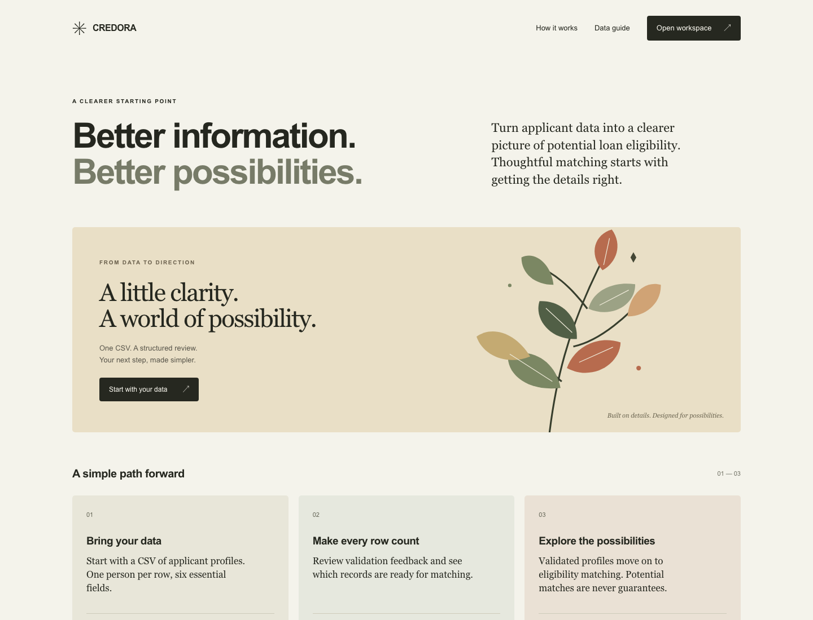
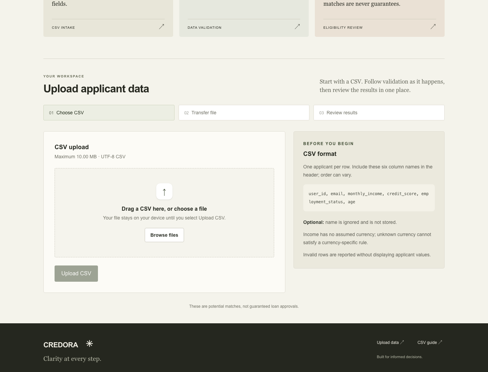
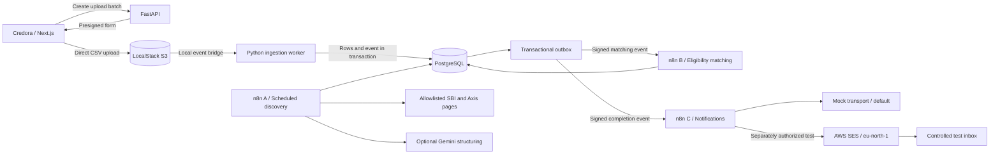
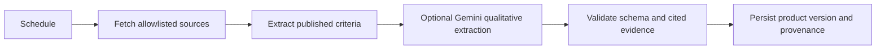
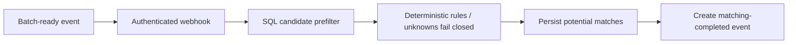
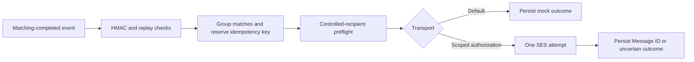

<div align="center">

# Credora

### Clarity before you apply.

**Turn applicant CSVs into structured data, potential loan matches, and controlled notifications.**

[UI preview](#ui-preview) · [How it works](#how-it-works) · [Tech stack](#tech-stack) · [Run locally](#run-locally) · [Verification](#verification-and-current-status)

</div>

## The brief

**Credora is a loan eligibility screening application.** It accepts applicant profiles in a CSV, validates and stores the records, discovers published loan-product criteria, and checks applicants against those criteria. Self-hosted n8n workflows coordinate discovery, matching, and notifications. The frontend makes uploading data and reviewing validation feedback straightforward.

**The problem it solves:** reviewing a large applicant spreadsheet against scattered lender requirements is repetitive and difficult to audit. Invalid rows, changing criteria, and incomplete information can lead to inconsistent screening. Credora brings these steps into a traceable pipeline: row-level validation, versioned product evidence, SQL candidate filtering, deterministic matching, and duplicate-resistant notifications.

**Who it is for:** teams exploring batch applicant screening and developers evaluating an event-driven lending workflow. This repository is a local demonstration, not a production lending service.

> **These are potential matches, not guaranteed loan approvals.** Missing or unsupported criteria fail closed. Official SBI and Axis products remain review-required; positive demonstration matches use explicitly synthetic products. Credora does not make credit decisions or promise eligibility.

## UI preview

Actual screenshots of the local Credora interface. These show the landing and empty upload states, with no applicant records or private configuration.

### Desktop



### Upload workspace



<details>
<summary><strong>Mobile preview</strong></summary>
<br />

</details>

The responsive interface includes keyboard navigation, drag-and-drop CSV selection, upload progress, bounded status polling, retry protection, and paginated row-validation feedback. Applicant values are omitted from validation errors.

## How it works

1. **Upload:** select a CSV. FastAPI creates a batch and returns a presigned object-storage upload form.
2. **Validate:** the ingestion worker validates rows and persists accepted records, rejection details, and an outbox event in PostgreSQL.
3. **Match:** a signed event invokes n8n Workflow B. SQL narrows the candidate pairs before deterministic eligibility checks; potential matches and a completion event are persisted.
4. **Notify:** Workflow C groups potential matches, validates the controlled recipient, and applies idempotency and attempt guards. The default transport is mock; real SES sending requires explicit scoped authorization.
5. **Keep product evidence current:** scheduled Workflow A crawls allowlisted lender pages and versions extracted criteria. Gemini can structure qualitative clauses, while deterministic validation checks supporting evidence.

### System architecture



LocalStack, PostgreSQL, n8n, and the internal helper run in Docker. The local S3 bridge emulates ingestion events; it is not a deployed AWS Lambda trigger. The Serverless template describes future AWS infrastructure and has only been validated offline.

### Workflow A — loan discovery



[Workflow export](workflows/discovery.json) · [Discovery guide](docs/discovery-workflow.md)

### Workflow B — eligibility matching



[Workflow export](workflows/matching.json) · [Matching policy](docs/matching-policy.md)

### Workflow C — notifications



The recipient is selected from controlled configuration, never from a CSV email field. Ambiguous historical sends are preserved, not automatically retried.

[Workflow export](workflows/notifications.json) · [Notification guide](docs/notification-workflow.md) · [Recovery review](docs/aws-ses-recovery-review.md)

## Tech stack

| Layer | Technologies | Purpose |
|---|---|---|
| Frontend | Next.js 16.4.1, React 19.3.1, TypeScript 5.9, Tailwind CSS 4.3 | Responsive upload and validation workspace |
| API | Python 3.12, FastAPI, Pydantic, Uvicorn | Upload authorization, batch status, validated internal steps |
| Persistence | PostgreSQL 16.15, SQLAlchemy 2, Psycopg 3, Alembic | Applicant records, versioned products, matches, outbox and audit history |
| Automation | Self-hosted n8n 2.43.5 | Discovery, matching and notification workflows |
| Object storage | LocalStack 4.11, Boto3 | Local S3-compatible presigned uploads |
| Extraction and AI | Beautiful Soup, HTTPX, Gemini adapter | Source parsing and optional evidence-bound qualitative extraction |
| Email | AWS SES, eu-north-1 | Controlled sandbox test delivery |
| Infrastructure | Docker Compose, Serverless Framework 4.44, Mangum | Local services and offline AWS/Lambda deployment artifacts |
| Quality | Pytest, Playwright, Ruff, Mypy, ESLint, TypeScript | Backend, browser, contract and static checks |

The local n8n installation uses a version-pinned SES request patch and sanitized diagnostics overlay. See [request contract](docs/aws-ses-request-contract.md) and [current image/rollout instructions](docs/aws-ses-safe-diagnostics.md). Package names and Compose identifiers retain their original `loan-engine` names for compatibility.

## Run locally

**Prerequisites:** Docker with Compose, Python 3.12, uv, Node 24, npm and Make.

### Fresh checkout only

```sh
git clone https://github.com/thisisanubhav/credora.git
cd credora
make init
uv sync --frozen
npm ci --prefix apps/web --no-audit --no-fund
make up
make db-upgrade db-role s3-init smoke
```

Start the host processes in separate terminals:

```sh
make api
```

```sh
make local-worker
```

```sh
make web-dev
```

Import and publish the three workflow exports using the [setup and demonstration guide](docs/submission-checklist.md). Complete local n8n owner setup and configure required credentials before using workflows. Merely uploading a CSV does not start a stopped outbox dispatcher.

**Existing populated environment:** follow [environment reconciliation](docs/environment-reconciliation.md) and the [current patched-image override instructions](docs/aws-ses-safe-diagnostics.md#canonical-startup-override). Do not rerun fresh setup/import commands on preserved workflows or recreate n8n with the base Compose file alone. Retain volumes, encryption settings and execution history.

| Service | Local endpoint |
|---|---|
| Credora frontend | http://127.0.0.1:3107 |
| FastAPI health | http://127.0.0.1:8000/health |
| n8n editor | http://127.0.0.1:5678 |
| PostgreSQL | `127.0.0.1:5432` |
| LocalStack | http://127.0.0.1:4566 |

### CSV format

Required headers; column order may vary:

```csv
user_id,email,monthly_income,credit_score,employment_status,age
```

One applicant per row, UTF-8, maximum 10 MB by default. See the [CSV contract](docs/csv-contract.md) for validation rules. No currency is inferred from income. The optional `name` column is not stored. A demo upload is explicitly marked synthetic and does not represent an actual lender offer.

### Configuration and safety

Use the ignored `.env` generated by `make init`; never commit credentials or copy a populated environment into an unrelated checkout. Frontend API routing defaults to `http://127.0.0.1:8000` and supports `NEXT_PUBLIC_UPLOAD_API_URL`.

Default notification settings:

```dotenv
NOTIFICATION_MODE=test
NOTIFICATION_TRANSPORT=mock
NOTIFICATION_SES_ENABLED=0
NOTIFICATION_SES_MAX_ATTEMPTS=0
```

Keep the notification dispatcher stopped in the preserved development environment. A live send needs a fresh reviewed batch, scoped authorization and explicit approval. Never reset or replay ambiguous notifications.

Gemini uses `GEMINI_API_KEY` and `GEMINI_MODEL` in the private helper, never a browser-exposed variable. Loading a key makes it available to scheduled discovery. The owner confirmed Free Tier with billing disabled; billing has not been independently inspected. See [Gemini readiness](docs/gemini-local-readiness.md).

## Verification and current status

| Capability | Status and evidence |
|---|---|
| CSV ingestion and PostgreSQL persistence | Implemented and tested locally with isolated fixtures |
| Official-source discovery | SBI and Axis extraction implemented; incomplete criteria remain review-required |
| Optimized matching | SQL prefilter plus deterministic checks; positive demos use synthetic products |
| Real AWS SES sending | **PASS:** execution 185 returned a Message ID, persisted `sent` at attempt count 1 |
| Actual inbox receipt | **PASS, owner-confirmed:** synthetic label and required disclaimer received in Gmail |
| Gemini | Key loaded and mocked adapter tests pass; successful live Gemini API usage **not yet verified** |
| Cloud infrastructure | Serverless configuration and Lambda packaging validated offline; not deployed |
| Submission | Evaluator access, demonstration video and submission remain outstanding |

See [SES success evidence](docs/aws-ses-success-evidence.md). Inbox receipt is owner-attested; a received-email screenshot/video has not been supplied. Historical failed attempts remain in the audit trail. The app is not fully submission-ready.

### Recorded checks

- Frontend redesign: **12 tests passed** (4 unit, 8 mocked browser tests), TypeScript, ESLint and production build passed. Credora rename received a subsequent keyboard/mobile smoke check.
- Latest Gemini-readiness regression: **106 passed, 1 skipped** across discovery and notification tests; Ruff and Mypy passed. Gemini responses were mocked.
- SES acceptance and inbox confirmation were recorded separately from automated tests; no test suite implies real email receipt.

Run local checks using isolated test databases and mocked provider transports:

```sh
make web-test web-e2e web-lint web-typecheck web-build
make discovery-test matching-test notification-test
make lint typecheck
make aws-config-offline aws-package-local
```

Do not run destructive fixtures against the application database. See [test evidence](docs/final-test-evidence.md) and [release verification](docs/release-verification.md) for historical scope.

### Measured performance

| Component benchmark | Recorded result |
|---|---|
| Ingestion of 10,000 rows | 0.615 seconds |
| Theoretical comparisons: 10,000 users × 50 synthetic products | 500,000 |
| SQL candidate pairs | 100,499 — approximately 79.9% reduction |
| SQL paging plus deterministic matching | 8.058 seconds |

These are historical single-run component measurements, not full end-to-end n8n timings or production throughput. No LLM calls occurred in the benchmark. [Methodology and limitations](docs/performance-report.md).

## Security boundaries

- Local API and service ports bind to loopback. The local UI has no production OIDC login; do not expose it publicly as-is.
- Future AWS templates require JWT validation and batch ownership; this cloud path is not deployed.
- Internal calls use HMAC, timestamp validation and replay protection.
- Restricted database roles, event idempotency, controlled recipients and one-attempt SES guards constrain execution.
- Product provenance and synthetic isolation prevent demonstration criteria from being presented as real bank offers.
- Keys, backups, raw provider logs and private addresses stay outside tracked documentation.

[Security review](docs/security-audit.md) · [AWS deployment design](docs/aws-deployment-design.md)

## Repository map

```text
apps/web/               Credora frontend
apps/api/               Public local upload/status API
apps/*_api/             Internal workflow helpers
services/ingestion/     CSV validation and persistence
services/discovery/     Crawling, extraction and Gemini adapter
services/eligibility/   Matching and transactional outbox dispatch
services/notifications/ Recipient guards, content, idempotency and recovery
database/              Alembic migrations
workflows/             Portable n8n A/B/C exports
infrastructure/        Compose, pinned images and Serverless configuration
patches/               Version-pinned n8n SES corrections
scripts/               Local setup and controlled operational tools
tests/                 Backend, infrastructure and notification regression
benchmarks/            Reproducible component measurements
docs/                  Architecture, evidence, guides and UI snapshots
```

## Further reading

[Architecture](docs/final-architecture.md) · [Submission summary](docs/submission-summary.md) · [Assignment compliance](docs/assignment-compliance-final.md) · [Demo script](docs/final-demo-script.md)

Earlier evidence retains the original project name, **Loan Eligibility Engine**, and historical branch names. Credora is the current product and repository name; those records preserve the history rather than describe a separate application.
