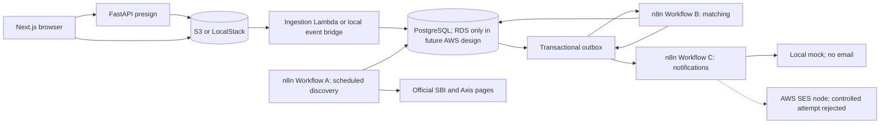

# Loan Eligibility Engine

An event-driven, local-first demonstration that ingests CSV batches, discovers personal-loan products, evaluates *potential* eligibility, and prepares test notifications through self-hosted n8n. It does not approve loans.

> **Submission boundary:** ₹0 budget. LocalStack is not AWS S3, local PostgreSQL is not RDS, and a mock notification is not a received SES email. A restricted AWS SES test identity and IAM user exist, but the one controlled live SES node attempt returned `Forbidden`; there is no provider Message ID or confirmed inbox receipt. No Gemini request succeeded. Bank products remain review-required; positive demonstration matches use unmistakably synthetic products only.

**Current local development environment:** use the populated SES worktree and Compose project described in [environment reconciliation](docs/environment-reconciliation.md). Its API is <http://127.0.0.1:8000>, frontend is <http://127.0.0.1:3107>, n8n is <http://127.0.0.1:5678>, PostgreSQL is on port 5432, and LocalStack is on port 4566. Keep notification transport in mock mode, SES disabled, and the outbox dispatcher stopped. [Release verification](docs/release-verification.md) records the latest isolated checks.

## Quick start — local, no cloud account

Use Docker with Compose, Python 3.12+, [uv](https://docs.astral.sh/uv/), Node 24 LTS, npm, and `make`. From a clean clone:

```sh
make init
uv sync --frozen
npm ci --prefix apps/web --no-audit --no-fund
make up
make db-upgrade db-role s3-init smoke
make discovery-import matching-import notification-import
docker compose --project-directory . --env-file .env -f infrastructure/docker-compose.yml exec -T n8n n8n publish:workflow --id=loanDiscoveryM4
docker compose --project-directory . --env-file .env -f infrastructure/docker-compose.yml exec -T n8n n8n publish:workflow --id=loanMatchingM5
docker compose --project-directory . --env-file .env -f infrastructure/docker-compose.yml exec -T n8n n8n publish:workflow --id=loanNotificationsM6
docker compose --project-directory . --env-file .env -f infrastructure/docker-compose.yml restart n8n
```

Open the n8n editor at <http://localhost:5678> (complete its local owner setup if prompted). Open three more terminals for `make api`, `make local-worker`, and `make web-dev`; use <http://127.0.0.1:3107>. The dispatcher remains stopped in the preserved SES development environment. A fresh clone with no historical recovery records may use the synthetic demo commands in the [demonstration guide](docs/final-demo-script.md), but do not replay the preserved SES events. The UI's synthetic demo checkbox additionally requires `NEXT_PUBLIC_ENABLE_DEMO_UPLOAD=1` for `make web-dev`. Without it, uploaded users will not automatically match the incomplete bank criteria. The mock branch records notifications but sends nothing. If Docker restarts, rerun `make up s3-init` before browser upload; this was necessary in the clean-clone validation.

See [fresh-checkout and demonstration steps](docs/submission-checklist.md) and the [final architecture diagrams](docs/final-architecture.md). Never copy an existing `.env` into a new checkout; `make init` generates local-only keys. All editor, API, S3-emulator, and database ports bind to loopback.

## What this demonstrates

| Capability | Local evidence | Limit |
|---|---|---|
| Bulk upload | Browser → presigned LocalStack POST → Python ingestion → PostgreSQL | AWS S3/Lambda/RDS not run |
| Discovery | Scheduled n8n Workflow A crawls official SBI and Axis pages | Both products remain review-required; Gemini not called |
| Matching | n8n Workflow B uses SQL candidate reduction and deterministic rules | Positive results use isolated synthetic fixtures |
| Notifications | n8n Workflow C groups potential matches, guards recipients, includes an AWS SES node | Mock transport and one failed controlled SES attempt; no accepted send or inbox receipt |

The assignment's 5–10 minute video and received SES email have **not** been produced. See [submission summary](docs/submission-summary.md) for honest compliance status and manual submission steps.

## Architecture and engineering decisions



Python keeps the ingestion and validated helper operations small and testable; n8n owns the workflow stages and order. PostgreSQL removes hard-failing candidate pairs before deterministic decisions, while unknown currency or unsupported lender criteria fail closed. The outbox preserves a committed batch when n8n is unavailable and retries with signed, idempotent events. Product versions retain official URL and cited evidence. [The full architecture](docs/final-architecture.md) explains sequences, recovery, provenance, and synthetic isolation.

## Tests and measured performance

`uv run --frozen --env-file .env pytest tests -q`, `make smoke`, `make web-test web-e2e web-lint web-typecheck web-build`, `make lint typecheck`, and `make aws-config-offline aws-package-local` are local/offline gates. Browser E2E needs Playwright Chromium (`cd apps/web && npx playwright install chromium`). `make matching-benchmark` and `uv run --frozen --env-file .env python -m benchmarks.ingestion.run` reproduce the controlled measurements in [performance report](docs/performance-report.md): 10,000-row parse/persist 0.615 s; 10,000 × 50 theoretical pairs reduced from 500,000 to 100,499 SQL candidates (79.9% reduction), with 8.058 s SQL-plus-deterministic evaluation and **zero LLM calls**. These are single local observations, not production throughput or full n8n-at-scale results.

## Security and deployment limits

The local API is unauthenticated and loopback-only. The *future* AWS HTTP API template requires a verified JWT subject and batch ownership, but the browser has no OIDC sign-in; do not expose it by disabling authorization. Dispatcher/webhook and internal helper stages use HMAC, timestamps, replay fences, and restricted database roles. The local n8n Code-node signer can access an environment key and is safe only in a single-owner loopback editor. Recipient routing is test-only, with mock transport by default. [Security audit](docs/security-audit.md) and [AWS deployment guide](docs/aws-deployment-guide.md) list cloud prerequisites. `infrastructure/serverless.yml` was validated and packaged offline, **not deployed**. Future RDS, SES, identity, network, and cost approvals are outside this ₹0 submission.

## Reviewer navigation

- [Requirements/evidence matrix](docs/assignment-compliance-final.md) and [final test evidence](docs/final-test-evidence.md)
- [Three workflow exports](workflows/), [node-by-node discovery](docs/discovery-workflow.md), [matching](docs/matching-workflow.md), and [notification](docs/notification-workflow.md)
- [CSV contract](docs/csv-contract.md), [database design](docs/database-design.md), [optimization](docs/optimization-strategy.md), and [benchmark](docs/performance-report.md)
- [Zero-budget AWS design](docs/aws-deployment-design.md), [offline Serverless template](infrastructure/serverless.yml), and [local Compose](infrastructure/docker-compose.yml)
- [Demo script](docs/final-demo-script.md), [demo checklist](docs/final-demo-checklist.md), and [submission checklist](docs/submission-checklist.md)

## Pipeline flow

1. The Next.js UI requests a short-lived presigned S3 POST and sends the CSV directly to S3 or local LocalStack.
2. An S3 `ObjectCreated` event invokes a Python ingestion Lambda.
3. The Lambda validates the CSV and atomically persists an upload batch and its users in PostgreSQL.
4. The outbox dispatcher invokes an authenticated n8n matching webhook with the committed batch identifier.
5. n8n runs set-based SQL pre-filtering, deterministic rules, and only then any necessary bounded LLM checks.
6. Qualified *potential* matches are persisted idempotently; Workflow C groups new matches by user. The default local branch records mock notifications. One separately controlled SES attempt was rejected and has not produced a confirmed email.
7. Separately, a scheduled n8n workflow discovers products from an allowlist of public sources, extracts source-grounded criteria with Gemini Flash where useful, validates the JSON deterministically, and upserts versioned products.

See the [architecture](docs/architecture.md) for diagrams and failure handling.

## Documentation

- [Requirements and traceability](docs/requirements.md)
- [Architecture](docs/architecture.md)
- [Database design](docs/database-design.md)
- [Optimization strategy](docs/optimization-strategy.md)
- [Development roadmap](docs/development-roadmap.md)
- [CSV contract and sample findings](docs/csv-contract.md)
- [Frontend and browser evidence](docs/frontend-evidence.md)
- [M9 assignment coverage and QA audit](docs/qa-audit.md)
- [Security audit](docs/security-audit.md)
- [Performance measurements](docs/performance-report.md)
- [Bug fixes](docs/bug-fixes.md)
- [Sanitized final test evidence](docs/final-test-evidence.md)
- [M9.1 requirement-by-requirement compliance](docs/assignment-compliance-final.md)
- [M9.1 remediation and terminal workflow evidence](docs/m9-1-remediation.md)

## Repository layout

```text
.
├── apps/
│   ├── api/                    # Presign HTTP API and batch/error status
│   └── web/                    # Minimal Next.js upload UI
├── services/
│   ├── ingestion/              # S3-triggered CSV validation and persistence
│   ├── discovery/              # Allowlisted crawler and source-grounded persistence steps
│   ├── eligibility/            # SQL prefilter, deterministic rules, dispatcher
│   └── notifications/          # Grouping, templates and reservations
├── workflows/
│   ├── discovery.json          # Workflow A export
│   ├── matching.json           # Workflow B export
│   └── notifications.json      # Workflow C export
├── database/
│   └── migrations/             # Alembic migrations
├── infrastructure/
│   ├── serverless.yml          # AWS declarations; no deployment is performed by default
│   └── docker-compose.yml      # PostgreSQL, n8n, LocalStack S3 emulator
├── tests/
│   ├── unit/                   # Schema and validation
│   ├── integration/            # Real PostgreSQL migrations/constraints
│   └── ingestion/, discovery/, matching/, notifications/, infrastructure/
└── docs/
```

This is a modular monorepo, not a set of independently deployed microservices. `services/` contains reusable, independently testable backend packages plus the version-controlled SQL/Code-node sources embedded in n8n exports; n8n remains the business-workflow orchestrator. The split keeps Lambda handlers thin and prevents workflow logic from becoming unreviewable or duplicated.

| Directory | Why it exists |
|---|---|
| `apps/` | User-facing deployable entry points: the small HTTP API and web UI. |
| `services/` | Testable ingestion/discovery modules and n8n-owned eligibility source artifacts, without forcing separate deployments. |
| `workflows/` | Reviewable, importable n8n JSON plus version-controlled templates. |
| `database/` | Schema evolution and explicitly local/test seed data. |
| `infrastructure/` | Keeps cloud and local runtime declarations separate from application logic. |
| `tests/` | Separates fast logic checks, real-PostgreSQL integration, boundary contracts, and end-to-end evidence. |
| `docs/` | Holds the architectural reasoning and traceability that would make the implementation defensible in review. |

## Local development (M1)

### Prerequisites

- Docker Engine/Desktop with Compose v2 or newer, running locally. M1 was verified with Docker Engine 29.4.0 and Compose 5.1.2.
- Python 3.9+ for the standard-library-only environment and smoke scripts. M2 Python models and tests require Python 3.12+; `.python-version` selects 3.12. On this host, `python3` resolves to 3.9.6, while `python3.12` is installed separately (3.12.14).
- `uv` for the locked M2 Python dependencies. Run `uv sync --frozen` once after checkout; `uv run --frozen` in the Make targets then uses the local environment.
- `make` for the root commands. Equivalent Docker Compose commands are shown below.
- Node is not needed for the M1 containers. The M7 frontend uses Node 24 LTS via `.nvmrc` (Node 22+ supported by the pinned Next.js 16); the host used Node 25.8.1 for verification because Node 24 was unavailable.

The containers are pinned to `postgres:16.15-bookworm` and `n8nio/n8n:2.43.5`. PostgreSQL 16 and n8n 2.43.5 both publish arm64 and amd64 images. n8n 2.43.5 is a stable release and supports PostgreSQL persistence and the `/healthz` endpoint. See the [PostgreSQL image tags](https://hub.docker.com/_/postgres), [n8n Compose guide](https://docs.n8n.io/deploy/host-n8n/install-options/use-a-cloud-provider/use-docker-compose/), [n8n database settings](https://docs.n8n.io/deploy/host-n8n/configure-n8n/basic-configuration/use-environment-variables/database/), and [n8n endpoint settings](https://docs.n8n.io/deploy/host-n8n/configure-n8n/basic-configuration/use-environment-variables/endpoints/).

### First start

From the repository root:

```sh
make init       # Create ignored .env with three independent random local secrets
make config     # Validate environment and Compose configuration without printing secrets
make up         # Start PostgreSQL, wait for health, then start n8n and wait for health
make smoke      # Check both databases, authentication, HTTP, networking, volumes, bindings
```

`make init` refuses to overwrite an existing `.env`. `.env` is gitignored and created with mode `0600`. Review non-secret settings in [.env.example](.env.example) before starting; the generator fills only `POSTGRES_PASSWORD`, `N8N_DB_PASSWORD`, and `N8N_ENCRYPTION_KEY`. Keep the encryption key stable as long as the n8n database and volume are retained, or stored n8n credentials may become unreadable. The local environment uses `N8N_SECURE_COOKIE=false` only because its endpoint is loopback HTTP; a public deployment needs HTTPS and a different security configuration.

| Variable | Purpose |
|---|---|
| `COMPOSE_PROJECT_NAME` | Names this checkout's Compose containers, network, and volumes. Change it if another checkout uses the same name. |
| `POSTGRES_DB`, `POSTGRES_USER`, `POSTGRES_PASSWORD` | Application database and local bootstrap/migration administrator. Do not use this role in application runtime. |
| `POSTGRES_PORT` | Host-side PostgreSQL port on `127.0.0.1`; container port is always 5432. |
| `APP_DB_USER`, `APP_DB_PASSWORD` | Restricted application DML login, provisioned by `make db-role`; not the n8n internal login. |
| `TEST_DB_NAME` | Dedicated migration/integrity test database, required to end in `_test`. |
| `N8N_DB_NAME`, `N8N_DB_USER`, `N8N_DB_PASSWORD` | Separate n8n internal database and login, created only on first PostgreSQL volume initialization. |
| `N8N_HOST`, `N8N_PORT`, `N8N_PROTOCOL`, `N8N_WEBHOOK_URL` | Loopback editor URL and local webhook base URL; the validation script keeps them consistent. |
| `N8N_ENCRYPTION_KEY` | Stable key for n8n credential encryption. Never commit or rotate casually. |
| `GENERIC_TIMEZONE` | Timezone for n8n schedules; UTC by default. |

PostgreSQL initializes both databases in UTF-8. The official entrypoint creates `loan_engine`; `infrastructure/postgres/init/01-create-n8n-db.sh` creates `n8n` and its restricted login. The script runs when the named PostgreSQL volume is empty. Existing volumes are not reinitialized by `make up`, so editing database names or passwords in `.env` after first start does not change existing database credentials. The n8n data directory and PostgreSQL data each use a named volume.

### Access, inspection, and shutdown

- Open the n8n editor at <http://localhost:5678> (or the configured local `N8N_PORT`). Complete n8n's first-run owner setup locally. Import Workflow A with `make discovery-import`.
- Connect a database client to `127.0.0.1:5432` (or `POSTGRES_PORT`). Use the application database name and local bootstrap login from `.env`. Inside Compose, the host is `postgres` and the port is `5432`. n8n itself uses its separate `N8N_DB_NAME` and `N8N_DB_USER`.
- `make status` shows container state and health. `make logs` follows the last 100 log lines; stop following with Ctrl+C. Logs should not contain credentials; do not paste private log output into public issues.
- `make down` stops and removes containers/network while preserving both data volumes. `make up` reuses them.

The equivalent Compose invocation from the repository root is:

```sh
docker compose --project-directory . --env-file .env -f infrastructure/docker-compose.yml ps
```

To erase **only this Compose project's local PostgreSQL and n8n data**, first check `COMPOSE_PROJECT_NAME` in `.env` and run the command below from this repository root. This permanently removes local databases, n8n users, workflows, and encrypted credentials; `make down` alone does not.

```sh
docker compose --project-directory . --env-file .env -f infrastructure/docker-compose.yml down --volumes
```

### Troubleshooting

| Symptom | Check |
|---|---|
| `make up` cannot connect to Docker | Start Docker Desktop/daemon and run `docker info`. `make config` can still validate Compose syntax without the daemon. |
| Port 5432 or 5678 already in use | Set a free `POSTGRES_PORT` or `N8N_PORT` in `.env`; update `N8N_WEBHOOK_URL` to the matching localhost URL, then rerun `make config`. |
| PostgreSQL is healthy but n8n fails to connect | Read `make status` and `make logs`. Verify `N8N_DB_*` values match the credentials used when the PostgreSQL volume was first initialized. |
| n8n starts but `/healthz` fails | Wait for database migrations, then inspect `make logs`; n8n may need longer on its first run. |
| Changed encryption key after first run | Restore the original ignored `.env` value. Regenerating the key does not decrypt stored credentials. |
| Changed database name/password after first run | Restore the original `.env`, or deliberately reinitialize the project's volumes after backing up wanted data. The init script is not a migration tool. |

### Database foundation (M2)

For an existing M1 checkout, run `python3 scripts/local_env.py extend` once. It appends only the new M2 settings and a random runtime password to the ignored `.env`; it does not overwrite the three existing local secrets. New checkouts receive all settings from `make init`. Then, from the repository root:

```sh
uv sync --frozen
make up
make db-upgrade   # Apply Alembic revisions to the application database as bootstrap owner
make db-role      # Create/refresh restricted application runtime permissions
make db-connect   # Verify runtime connectivity and absence of DDL/DELETE privileges
make db-status    # Display the applied Alembic revision
make db-test      # Create/validate dedicated *_test DB; round-trip migrations there
make lint
make typecheck
make smoke        # Recheck the M1 containers and database isolation
```

`make db-test` downgrades and rebuilds schema **only** in `TEST_DB_NAME`; it never targets `POSTGRES_DB` or the n8n database. It removes previous test data. The application migration is non-destructive on upgrade; do not run `alembic downgrade base` on a database containing wanted data. `make db-role` is idempotent and should be rerun after future migrations. It grants DML without DDL/DELETE and permits product lifecycle metadata updates but not edits to historical eligibility rules. Database and test credentials remain only in ignored `.env` (mode `0600`); Alembic's INI contains no URL.

The schema has nine application tables: the eight planned entities plus `notification_matches`, a join table that enforces match-to-notification foreign keys and at-most-one notification reservation per match. Product versions retain source evidence and a rule document. Unknown criteria are explicit and cannot be marked verified as an empty document. `matches.status = 'potential'` is **not** approval. See [M2 design decisions and query/index examples](docs/database-design.md#m2-implementation-review-2026-10-15). No real user or loan data is seeded.

### CSV ingestion (M3)

Existing M2 checkouts should run `python3 scripts/local_env.py extend-m3` once. This appends local S3 emulator and ingestion settings to the ignored `.env`. A fresh `make init` includes them. `test/test` are LocalStack's public emulator-only dummy keys, **not** AWS credentials. Production must use an IAM execution role and omit `S3_ENDPOINT_URL`; never deploy the loopback-only unauthenticated API as a public endpoint.

From the repository root:

```sh
uv sync --frozen
make up                 # PostgreSQL, n8n, LocalStack; loopback-only ports
make db-upgrade         # Additive M3 migration; preserves existing data
make db-role            # Refresh runtime DML grants after migration
make s3-init            # Create local S3 bucket idempotently
make api                # Optional: serve FastAPI on 127.0.0.1:8000
make ingestion-test     # Real dedicated *_test PostgreSQL + LocalStack
make ingestion-e2e      # One-command presigned upload, worker, outbox, replay check
```

`POST /uploads` takes JSON `{"filename":"users.csv","size_bytes":1234,"content_type":"text/csv"}` and an `Idempotency-Key` header (8–128 characters). It creates a batch and returns `batch_id` plus `upload.url` and signed multipart `upload.fields`. POST the CSV directly to that URL with those fields and a `file` part; CSV bytes never traverse FastAPI. Replaying the same key and metadata while the batch is still `uploaded` returns the same batch and a fresh short-lived policy; changed metadata returns 409. `GET /uploads/{batch_id}` gives safe status/counts and the first 100 error examples; `GET /uploads/{batch_id}/errors?offset=0&limit=100` pages through all row errors; `GET /health` returns process liveness. No authentication or rate limiting is implemented, so bind only to loopback and do not expose this API to a network.

In production, S3 `ObjectCreated` invokes `services.ingestion.worker.lambda_handler`. Locally, `make ingestion-e2e` uploads through the signed POST to LocalStack and synthesizes that AWS event envelope into the same handler. LocalStack does **not** automatically invoke a Lambda. The worker validates bucket/key/batch/ETag, streams UTF-8 CSV in configurable insert chunks, commits accepted rows with a stable `upload_batch.ready.v1` outbox event, and never contacts n8n. Valid rows are retained when other rows fail validation. An all-invalid or malformed file creates no matching event. Batch states are `uploaded → processing → processed | processed_with_errors | rejected`; transient failures become `failed` and can retry. Stale processing leases can be reclaimed after `INGESTION_LEASE_SECONDS`; a processing token fences older attempts. Duplicate S3 events return without inserting more users or events.

The [CSV contract](docs/csv-contract.md) specifies exact sample headers, validation and safe row-error handling. Every rejected row number and its error codes are retained in `upload_row_errors`; raw invalid rows are not copied to another personal-data store. `name` is ignored. `income_currency` is nullable because the sample specifies no currency. Unknown employment labels preserve source text and normalize to `other`, which must fail closed for automated eligibility. The worker holds one database transaction while parsing each bounded file; the default 10 MB limit and a 15-minute lease suit assignment-scale files, but sustained larger loads require measuring transaction duration and likely a chunk/checkpoint redesign. The M5/M6 dispatcher now atomically claims pending outbox rows with `FOR UPDATE SKIP LOCKED` and delivers signed batch events to n8n with retries and failure recovery.

M3 settings in `.env`: `LOCALSTACK_PORT` (loopback emulator), `AWS_ACCESS_KEY_ID`/`AWS_SECRET_ACCESS_KEY` (local dummy only), `AWS_DEFAULT_REGION`, `S3_ENDPOINT_URL`, `S3_BUCKET`, `CSV_MAX_BYTES`, `CSV_CHUNK_SIZE`, `UPLOAD_URL_TTL_SECONDS`, and `INGESTION_LEASE_SECONDS`. The S3 bucket has a persistent named volume. `make down` preserves it; `docker compose --project-directory . --env-file .env -f infrastructure/docker-compose.yml down --volumes` removes **all three** project data volumes and is destructive. Check the Compose project name and back up wanted data first.

### Loan product discovery (M4)

Workflow A is the real n8n export at [`workflows/discovery.json`](workflows/discovery.json). It schedules or manually starts a source-respectful crawl of the official [SBI](https://sbi.bank.in/web/personal-banking/loans/personal-loans/sbi-personal-loan) and [Axis Bank](https://www.axis.bank.in/loans/personal-loan) personal-loan pages. The internal `discovery` Compose service performs bounded fetch/extract/validate/persist steps; n8n controls their order, the optional Gemini branch, and execution tracking. Only source-grounded partial criteria are stored. Live products remain `review_required`, not guaranteed eligibility. See [source research](docs/loan-sources.md) and the [node-by-node workflow guide](docs/discovery-workflow.md).

```sh
uv sync --frozen
make up
make db-upgrade
make db-role
make discovery-test    # Fixture tests; dedicated discovery_test database
make discovery-import  # Import export into the running local n8n instance
make discovery-run     # Live manual n8n execution; temporarily restarts editor
```

`GEMINI_API_KEY` is optional and absent by default. `GEMINI_MODEL` defaults to Google's documented `gemini-3.8-flash`; a missing key leaves Gemini-dependent checks blocked and does not prevent deterministic discovery. Never commit the key or paste it into n8n nodes. The n8n workflow is imported inactive; activate its 24-hour schedule explicitly in the editor only when approved for periodic access. The internal service publishes no host port. PostgreSQL migrations remain separate from the restricted runtime role. M4 does not crawl arbitrary URLs, match users, or send email.

### Optimized eligibility matching (M5)

For an existing checkout, run `python3 scripts/local_env.py extend-m5` once to create the ignored local HMAC secret and enable the explicitly local synthetic-demo mode. Then run:

```sh
make up
make db-upgrade
make db-role
make matching-test
make matching-import
docker compose --project-directory . --env-file .env -f infrastructure/docker-compose.yml exec -T n8n n8n publish:workflow --id=loanMatchingM5
docker compose --project-directory . --env-file .env -f infrastructure/docker-compose.yml restart n8n
uv run --frozen --env-file .env python -m scripts.seed_matching_demo
make matching-e2e
make matching-benchmark
```

`make matching-dispatch` processes one due outbox event; run `uv run --frozen --env-file .env python -m services.eligibility.dispatcher --watch` for local continuous dispatch/reconciliation. Do not enable `ALLOW_SYNTHETIC_DEMO=1` or expose the HTTP webhook in production. The [matching policy](docs/matching-policy.md), [workflow/recovery guide](docs/matching-workflow.md), and [benchmark](docs/matching-benchmark.md) explain fail-closed decisions, HMAC/replay protection, page receipts, and measured selectivity. M5 never sends an email or claims approval.

### Test-only notification workflow (M6)

Existing checkouts: run `python3 scripts/local_env.py extend-m6` once. Defaults are **mock-only**, with a non-deliverable placeholder inbox. No CSV address is ever used as a delivery recipient. From the repository root:

```sh
make up
make db-upgrade
make db-role
make notification-test
make notification-import
docker compose --project-directory . --env-file .env -f infrastructure/docker-compose.yml exec -T n8n n8n publish:workflow --id=loanNotificationsM6
docker compose --project-directory . --env-file .env -f infrastructure/docker-compose.yml restart n8n
make notification-e2e
```

The same dispatcher now routes Workflow B completion events to Workflow C. `make notification-e2e` performs real local ingestion and both n8n workflows; its final notification acceptance is mocked, so **no email is sent**. It proves one message group for a user with one synthetic match, one for a user with two, none for an unmatched user, and duplicate-event safety. See [notification policy](docs/notification-policy.md), [Workflow C/SES setup](docs/notification-workflow.md), and [sanitized evidence](docs/notification-evidence.md). To attempt a real SES send, a controlled verified inbox and sender, n8n AWS credential, explicit `.env` switches, and an inbox receipt check are required. SES credentials/identities were unavailable for M6; no receipt is claimed. The installed SES node sends HTML here, while the helper also generates plain text; its `email.send` operation does not produce multipart alternatives.

### Browser upload interface (M7)

Use Node 24 LTS (`nvm use` if available), then from the repository root:

```sh
python3 scripts/local_env.py extend-m7   # Existing checkout only; adds ignored FRONTEND_ORIGIN
make up
make db-upgrade
make db-role
make s3-init                         # Reapply LocalStack bucket CORS after origin changes
make web-install                     # Pinned npm lockfile dependencies
make api                             # Terminal 1: 127.0.0.1:8000
make local-worker                    # Terminal 2: LocalStack object-created bridge
make web-dev                         # Terminal 3: 127.0.0.1:3107
```

Open <http://127.0.0.1:3107>. Use the six [CSV columns](docs/csv-contract.md); choose or drop a UTF-8 `.csv` under 10 MB and click **Upload CSV**. The page asks `POST /uploads` for a short-lived, size-constrained policy using a per-file idempotency key, then sends the multipart form directly from the browser to LocalStack. CSV bytes never pass through Next.js or FastAPI. The browser polls `GET /uploads/{batch_id}` and pages `GET /uploads/{batch_id}/errors`; it shows only counts, row numbers, field names, and safe reasons, not applicant values. The batch ID remains in the URL so the status can be recovered after reload. Automatic polling is bounded (90 checks, roughly four minutes) and stops at ingestion-terminal states; use **Refresh status** to check a later matching state. Neither match counts nor notification counts are invented.

The root ignored `.env` contains `FRONTEND_ORIGIN=http://127.0.0.1:3107` for the API and LocalStack CORS rules. The frontend's public, non-secret settings are in [apps/web/.env.local.example](apps/web/.env.local.example); copy to `.env.local` only when changing the API address or 10 MB advisory limit. The API and presigned S3 URL must both use browser-reachable loopback addresses, **not** Compose names such as `localstack`. Port 3107 avoids an unrelated service on this host's port 3000. If the browser reports a CORS or storage error, confirm `make api`, `make up`, `make s3-init`, and the exact `FRONTEND_ORIGIN`; rerun `make s3-init` after changing origins. If a policy expires, **Retry upload** reuses the idempotency key and requests fresh fields while the batch is still awaiting the object. If processing already began, use the batch URL/status instead of creating a new upload.

LocalStack does not invoke the ingestion Lambda automatically in this minimal setup. `make local-worker` polls known `uploaded` object keys on the loopback emulator and calls the **same** ingestion handler with an S3 event envelope. Production uses native S3 `ObjectCreated`; the bridge is local-only and must not be deployed as an AWS worker. Start the existing dispatcher separately if you want n8n Workflow B/C to advance the batch beyond ingestion; the UI itself never sends email. Keep M6 mock-only delivery defaults for local demos.

```sh
make web-test       # Contract/unit checks
make web-e2e        # Playwright Chromium UI flows with mocked API/S3 for determinism
make web-lint
make web-typecheck
make web-build
```

Install Chromium once with `cd apps/web && npx playwright install chromium`. A real browser-to-LocalStack upload and sanitized screenshots are described in [frontend evidence](docs/frontend-evidence.md). The upload API intentionally has no end-user authentication or rate limit; all M7 endpoints and containers are loopback-only. CORS restricts browser origins but is **not** authentication. Do not expose this setup publicly without the M8 security design.

### M8 AWS deployment readiness (offline only)

The authorized budget is **₹0**. M8 adds a future-oriented [Serverless definition](infrastructure/serverless.yml), a real upload-API Lambda adapter and native S3 ingestion binding, owner-scoped JWT API access, a local Linux Lambda zip builder, and offline infrastructure tests. It does **not** deploy, provision, send email, or contact AWS. The complete demo stays local with Docker PostgreSQL/n8n and LocalStack S3. The current browser has no OIDC login, so it cannot yet call the protected AWS API; do not remove JWT authorization to bypass this.

From the repository root: `uv sync --frozen`, `make aws-config-offline aws-test`, then `make aws-package-local`. The latter builds ignored `.build/m8/lambda.zip` from pinned dependencies and checks handler imports/package size without AWS. `make aws-preflight-offline` checks future deployment environment-variable shapes only; see [non-secret variable template](infrastructure/aws.env.example). No deploy command is provided. Serverless CLI packaging itself can resolve AWS account/SSM/S3 state, so it is **not** an offline check and was not run. Keep `.env`, `infrastructure/aws.env`, credentials and keys private.

See [deployment design](docs/aws-deployment-design.md), [conditional guide](docs/aws-deployment-guide.md), [cost inventory](docs/aws-cost-analysis.md), and [security review](docs/security-review.md). Future RDS, n8n hosting, identity provider, SES, and live AWS verification all require a separate approval and spending decision. The local M3–M7 setup remains unchanged.

### M9 local QA replay

`make up && make s3-init` restores the local containers and emulator bucket. Keep Workflow B/C imported and published, and run the local worker plus dispatcher watchers as documented above. For the opt-in browser-to-synthetic demonstration only, set `NEXT_PUBLIC_ENABLE_DEMO_UPLOAD=1` for the Next.js development server (the API also requires local `ALLOW_SYNTHETIC_DEMO=1`); select the conspicuously labelled checkbox. AWS mode rejects synthetic uploads regardless of that local switch. Run `NEXT_PUBLIC_ENABLE_DEMO_UPLOAD=1 npx playwright test tests/qa-real-local.spec.ts` from `apps/web` while FastAPI, the worker and dispatcher are running. The CSV goes from the real browser to LocalStack; n8n B/C may finish after the UI's ingestion-terminal view. All notifications are mock-only. The 10,000-row parser measurement is `uv run --frozen --env-file .env python -m benchmarks.ingestion.run`; it uses a guarded `_qa_ingestion_test` database and prints no sample emails. See the M9 audit links above for execution IDs, failure recovery and limitations.

### M9.1 authenticated n8n steps and terminal executions

Existing local checkouts: run `python3 scripts/local_env.py extend-m9-1` once to add a distinct ignored n8n-to-helper signing key, then `make up db-upgrade db-role`. Reimport all three workflow JSON exports, publish A/B/C with the n8n CLI or editor, and restart n8n; imports deactivate previously published webhooks. Workflow A's 24-hour schedule is active in the verified local instance. Every private HTTP step now has a preceding HMAC signer node; the helper rejects unsigned/replayed calls. `make notification-e2e` checks not only application state but also n8n's own terminal B/C execution records and final nodes. For a real browser test, run `NEXT_PUBLIC_ENABLE_DEMO_UPLOAD=1 QA_SCREENSHOT_DIR=../../artifacts/m9-1 npx playwright test tests/qa-real-local.spec.ts` from `apps/web` with the API, local worker, dispatcher and web server running.

The n8n Code signer reads its key from the container environment and requires `crypto` module access. This is suitable only for the single-owner loopback development instance; do not put a shared n8n editor on this configuration without isolating the task runner or moving the key into a credential-backed signer. n8n successful execution data is pruned after 72 hours or 1,000 records. Neither a mock notification nor a LocalStack object is evidence of AWS SES delivery or RDS operation. See [M9.1 remediation](docs/m9-1-remediation.md) for the verified execution IDs, remaining risk and key-rotation procedure.

