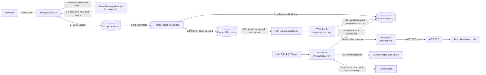
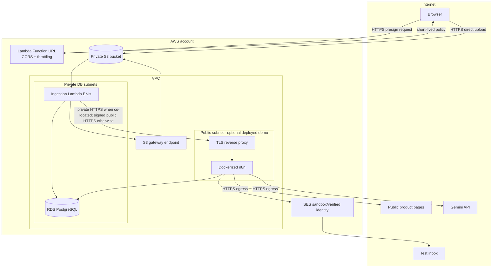

# System Architecture

## Decision summary

The recommended architecture is a good fit with four refinements:

1. The upload API returns a **presigned S3 POST policy**, not a generic proxy upload. A POST policy can restrict key prefix, content type, and size while the browser streams directly to S3.
2. The ingestion Lambda commits accepted users, batch completion, and a **transactional outbox event** in the same database transaction. It does **not** call n8n. An M5 dispatcher will deliver pending events after commit. This closes the “database commit succeeded but webhook failed” gap.
3. n8n is the explicit business-process coordinator. Its PostgreSQL nodes perform set-based pre-filtering, its workflow nodes execute deterministic/ambiguous checks, and Workflow C is called only after Workflow B completes successfully.
4. A cloud end-to-end deployment places the Dockerized n8n host in the same VPC as private RDS. Local development uses local PostgreSQL and n8n. A local n8n instance cannot safely query private RDS merely because Lambda can reach its webhook; that boundary must not be hand-waved.

This preserves the assignment’s intended architecture without adding a queueing platform, Kubernetes, or a fleet of microservices.

## Context and component architecture



### Trust and network boundaries



For M3 local development, FastAPI runs on loopback, PostgreSQL and n8n run in Compose, and LocalStack 4.11.0 emulates S3 on loopback. The E2E command feeds a real S3-compatible presigned POST to LocalStack, then invokes the same Lambda handler with a synthesized S3 `ObjectCreated` envelope. Automatic S3→Lambda delivery, AWS SES, and Gemini are not running locally. A real cloud deployment is optional.

M4 adds a non-public Compose `discovery` service at `http://discovery:8001` for testable bounded crawl, extraction, evidence validation, and versioned persistence steps. n8n Workflow A explicitly schedules, fans out, chooses the optional Gemini branch, sequences these HTTP steps, and records each source outcome. The service has no published port; n8n reaches it over the Compose network. This local placement is not yet a production deployment design: if n8n is moved to AWS, keep the helper private and authenticate its requests. See [Workflow A](discovery-workflow.md) and [source policy](loan-sources.md). Missing Gemini credentials or incomplete bank criteria never make a product matchable.

M5 adds Workflow B to the same self-hosted n8n instance and reuses the private helper for narrowly scoped matching steps. A local Python dispatcher leases committed `upload_batch.ready.v1` outbox rows, signs only UUIDs with HMAC, and POSTs to n8n's published webhook. n8n verifies and durably claims before HTTP 202, then orchestrates batch metadata, a 20-user/at-most-1,000-pair SQL page, deterministic decisions, optional capped Gemini advice, idempotent match writes, and an atomic `matching.completed.v1` outbox event for M6. The dispatcher reconciles stale acknowledged executions. See [matching workflow](matching-workflow.md) and [fail-closed policy](matching-policy.md). The earlier raw-request-body signature sketch is concretized as canonical sorted JSON because n8n forwards a parsed webhook body; the signed field set and timestamp are validated before any batch lookup.

## Component responsibilities

| Component | Responsibility | Explicit non-responsibility |
|---|---|---|
| Next.js UI | Choose CSV, obtain presigned policy, upload, display batch reference and safe errors. | Parsing users, matching, or possessing AWS credentials. |
| Presign API | Generate UUID batch key and a short-lived constrained S3 POST; apply CORS/rate limit. | Receiving CSV bytes or running business rules. |
| S3 | Durable upload handoff and event source; server-side encryption and lifecycle policy. | Data validation. |
| Ingestion Lambda | Verify event/object, parse bounded CSV, validate rows, bulk insert atomically, create outbox event. | Loan eligibility decisions or direct n8n delivery. |
| PostgreSQL/RDS | System of record, constraints, batch/outbox state, efficient candidate selection. | Autonomous workflow scheduling. |
| n8n Workflow A | Schedule, crawl orchestration, source extraction, schema validation, product upsert. | Inventing missing source criteria. |
| n8n Workflow B | Webhook verification, batch-scoped matching stages, metrics, match persistence, call Workflow C. | Re-parsing uploaded CSV or emailing sample addresses. |
| n8n Workflow C | Group newly created matches, safety-map recipients, send via SES, log idempotently. | Re-evaluating eligibility. |
| Gemini Flash | Convert cited product-page text into a constrained rule schema or evaluate a bounded qualitative ambiguity. | Numeric comparisons, filling missing facts, or making an unsupported final approval decision. |

## End-to-end sequences

### Upload, ingestion, and matching

```mermaid
sequenceDiagram
    autonumber
    participant UI as Next.js UI
    participant API as Presign API
    participant S3 as S3
    participant L as Ingestion Lambda
    participant DB as PostgreSQL
    participant N as n8n Workflow B
    participant C as n8n Workflow C

    UI->>API: Request upload policy (name, size, type)
    API-->>UI: batch_id + key + short-lived POST fields
    UI->>S3: Direct multipart/form-data upload
    S3-->>L: ObjectCreated event (at-least-once)
    L->>S3: HEAD then streamed GET
    L->>DB: BEGIN; insert/lock batch; bulk insert users; insert outbox; COMMIT
    Note over L,DB: M3 ends at the committed pending outbox event
    DB-->>N: M5 dispatcher will POST signed batch envelope
    N->>DB: claim batch event idempotently
    N->>DB: set-based candidate query
    N->>N: deterministic and rare ambiguity stages
    N->>DB: INSERT matches ON CONFLICT DO NOTHING
    N->>C: Execute Workflow with new match IDs
    C->>DB: claim notification key and load grouped matches
    C-->>DB: record sent/failed result
```

### Product discovery

```mermaid
sequenceDiagram
    autonumber
    participant T as n8n Schedule Trigger
    participant A as Workflow A
    participant S as Public source
    participant G as Gemini Flash
    participant V as Deterministic validator
    participant DB as PostgreSQL

    T->>A: Scheduled run
    loop Each enabled allowlisted source
      A->>S: Conditional GET, rate limited
      S-->>A: HTML/product page
      A->>A: Extract relevant text + source URL + content hash
      opt Criteria cannot be normalized deterministically
        A->>G: Source excerpt + strict JSON schema
        G-->>A: Structured candidate rules
      end
      A->>V: Validate types, ranges, evidence, contradictions
      alt complete and supported
        V->>DB: Versioned upsert; mark matchable
      else missing/ambiguous/invalid
        V->>DB: Preserve raw evidence; mark review_required/unmatchable
      end
    end
```

## The Lambda-to-n8n boundary

### Connectivity

- **Local:** ingestion is invoked by a test harness/emulator and calls `http://n8n:5678` on the Compose network. Local PostgreSQL is shared by both.
- **Cloud demo:** n8n runs as a single Docker Compose host in the AWS VPC. RDS is private and permits TCP 5432 only from the Lambda and n8n security groups. A TLS reverse proxy exposes only the production webhook path; the n8n editor is restricted by IP/VPN or kept private.
- **Externally hosted n8n alternative:** use authenticated HTTPS for the webhook, but n8n still needs a secure database route. Do not make RDS world-accessible. A VPN/tunnel adds complexity and is not the default.

The single-host n8n deployment is appropriate for an assignment and modest load. Multi-main/queue-mode n8n, Redis, and load balancing are deferred until availability or throughput measurements require them.

### Webhook authentication and replay protection

The future M5 outbox dispatcher sends a small envelope; it never sends the CSV or user records:

```json
{
  "event_id": "uuid",
  "event_type": "upload_batch.ready.v1",
  "batch_id": "uuid",
  "occurred_at": "RFC3339 timestamp",
  "object_key": "uploads/<batch-id>/users.csv"
}
```

Headers include `X-Loan-Event-Id`, `X-Loan-Timestamp`, and `X-Loan-Signature`. The signature is HMAC-SHA256 over `timestamp + "." + exact_request_body`. n8n verifies the signature in constant-time, rejects timestamps outside a five-minute window, validates the body schema, and atomically claims the unique event ID before work. TLS is mandatory outside Compose.

The shared secret lives in AWS Secrets Manager/SSM for Lambda and in n8n’s encrypted credential store, backed by a stable `N8N_ENCRYPTION_KEY`. It is never embedded in workflow JSON or logs. Rotation temporarily accepts current and previous secret versions.

### Retries, idempotency, and recovery

- S3 and Lambda delivery are at-least-once. `upload_batches.object_key` is unique; the Lambda locks or upserts the batch and never duplicates its users.
- The user rows and `outbox_events` event commit in one PostgreSQL transaction. M3 does not call n8n; an M5 dispatcher will do so only after that commit.
- The M5 dispatcher should use short connect/read timeouts and exponential backoff with jitter. It should treat `200/202/409-already-claimed` as success, retry `429/5xx/timeouts`, and quarantine permanent `4xx` schema/auth failures.
- If the M5 dispatcher dies after n8n accepts but before outbox acknowledgement, the same event is resent. The event claim and match unique constraints make this safe.
- A lightweight n8n reconciliation schedule queries stale pending outbox rows and re-enters Workflow B. This reuses n8n and PostgreSQL instead of adding Kafka/SNS/SQS to the normal path.
- The production template may attach an SQS DLQ to the ingestion Lambda. Operators can inspect and redrive after correcting the cause; local development does not require it.
- Workflow C reserves an idempotency key before SES. A timeout after the SES call is inherently ambiguous because SES and PostgreSQL are not one transaction; record the SES message ID when returned, retry cautiously, and expose ambiguous sends for manual review rather than blindly duplicating mail.

## n8n orchestration boundary

“Core business logic in n8n” is honored as follows:

- Workflow A owns scheduling, source iteration, extraction decisions, validation branches, and product persistence.
- Workflow B owns batch claiming, SQL pre-filter invocation, deterministic rule stages, any bounded LLM branch, match insertion, metrics, and workflow chaining.
- Workflow C owns grouping, personalization, recipient guardrails, SES invocation, and notification logging.
- SQL is executed through n8n PostgreSQL nodes. Version-controlled SQL files mirror the node queries for review and integration testing. Any non-trivial Code-node source is also kept as a testable file and embedded during workflow export/build; there is one source of truth, not a Python reimplementation with drift.
- Lambda is plumbing: parsing/validation/persistence and reliable event handoff only. It never decides eligibility.

## Security design

| Area | Control |
|---|---|
| Upload authorization | Short expiry; server-generated UUID key; exact key prefix; CSV MIME allowlist treated as advisory; content-length range; private bucket; Block Public Access. |
| File safety | HEAD before GET; hard byte/row/column limits; UTF-8 policy; bounded field lengths; streamed parsing; reject malformed headers and unexpected columns according to schema version. |
| IAM | Separate least-privilege roles: presign API can only sign/put under upload prefix; ingestion can read that prefix and required secret; no static AWS keys in the browser. |
| Encryption | HTTPS/TLS in transit; S3 SSE; RDS encryption; n8n credential encryption; redact secrets and user PII from logs. |
| Database | Private subnets, security-group allowlist, TLS, separate application/n8n roles, parameterized SQL, migration role separated from runtime roles. |
| n8n | Pin image version; disable public signup/telemetry if appropriate; restrict editor; expose only named webhook; HMAC/replay validation; encrypted credentials; do not commit credential-bearing exports. |
| Crawling | Source allowlist, robots/terms review, descriptive user agent, request rate limits/timeouts, maximum response size, redirect/SSRF protection, sanitize scraped text as untrusted data. |
| LLM | Prompt treats page content as data; strict response schema; temperature near zero; evidence spans/source hash; reject unsupported keys/ranges; no user PII unless a narrowly justified ambiguous check requires it. |
| Email | SES sandbox/verified identity; hard redirect/allowlist to owner-controlled aliases; do not address sample users; HTML escape dynamic values; send only new, claimed matches. |
| Supply chain | Lock dependencies/images, automated secret scanning, minimal images, vulnerability review before submission. |

The assignment does not require end-user authentication. Therefore the initial UI/API is local or access-restricted for demonstration. CORS is not authentication, and a public anonymous presign Function URL would create an upload-abuse/cost risk even with tight POST policies and reserved concurrency. Before any public deployment, choose one explicit control: IAM-authenticated Function URL with an appropriate browser identity mechanism, or API Gateway with real user authentication (for example Cognito). API keys embedded in the frontend are not accepted as authentication. This decision is intentionally deferred because public deployment itself is optional.

## Scalability, bottlenecks, and mitigations

| Concern | Likely effect | Initial mitigation | Scale trigger / later option |
|---|---|---|---|
| Large/malformed CSV | Lambda memory/time exhaustion | Direct S3 upload; byte/row limits; streaming parser; chunked bulk insert; fail clearly. | If validated files exceed Lambda’s practical duration, split manifests into SQS-driven chunks. |
| Lambda-to-RDS connections | Exhaust PostgreSQL connections under concurrent uploads | Reserved Lambda concurrency; SQLAlchemy `NullPool`; one transaction/connection per file; batch inserts. | Add RDS Proxy only after observed connection pressure. |
| Single n8n host | Downtime and limited concurrent workflow executions | Healthcheck, persistent volume/DB, bounded workflow concurrency, restart policy, idempotent recovery. | n8n queue mode + Redis/workers only if measured workload requires HA/parallelism. |
| Product-source changes | Missing/stale product data | Fixtures, selectors, content hash, last-success timestamp, fail closed, visible workflow error. | Per-source adapter update; layout self-healing remains optional. |
| Candidate explosion | 500,000 pairs and high workflow memory | Set-based SQL prefilter, paginate/stream candidates, process in chunks, no full Cartesian array in one n8n item. | Partitioning/materialized eligibility bands only after benchmarks. |
| LLM latency/quota | Slow, costly, nondeterministic runs | Normalize product rules once; deterministic matching; batch/cap ambiguous checks; cache by input hash; fail closed. | Manual-review queue or model fallback with explicit approval. |
| SES duplicates | Duplicate emails on retries | Notification claim/idempotency key and new-match grouping. | Provider event reconciliation if production delivery semantics require it. |

## Failure scenarios

| Failure | Detection | Recovery and user-visible state |
|---|---|---|
| Presign request invalid/rate-limited | 4xx with safe error code | User corrects file metadata/retries; no batch persisted. |
| Upload interrupted | Browser/S3 failure | Retry using a new short-lived policy; incomplete multipart uploads expire by lifecycle policy. |
| Invalid CSV/header | Batch marked `rejected` with summarized error | Fix CSV and upload a new batch; no partial hidden success for file-level errors. |
| Some invalid rows | Rejection counts and bounded error sample | Proposed policy: valid rows commit and batch becomes `processed_with_errors`; confirm this requirement before implementation. |
| Database unavailable | Lambda error/metrics; event retry | Idempotent retry; eventual DLQ; batch reconstructed from unique object key. |
| n8n unreachable (M5) | Pending outbox remains due | Dispatcher retry/backoff and n8n reconciliation; ingestion completion is unaffected. |
| Duplicate S3/webhook event | Unique keys/event claim conflict | Return success/already-processed; do not duplicate users or matches. |
| Crawl blocked/layout changed | HTTP/parser/schema failure and stale-source metric | Keep last verified version but mark freshness; do not overwrite with empty/invented criteria. |
| Gemini invalid/unsupported output | Schema/evidence validation failure | Retry within cap only for transient/model-format errors; then mark review-required/unmatchable. |
| Matching workflow partially fails | Execution record and batch claim state | Rerun same batch; unique match key prevents duplicates. |
| SES rejected/timeout | Notification attempt status/error | Retry definite failures; quarantine ambiguous sends; never fall back to sample address. |

## Cost implications

- Direct S3 upload avoids API Gateway/Lambda bandwidth and duration for file bodies.
- Lambda and S3 event processing are pay-per-use. Reserved concurrency protects RDS more than it affects cost.
- RDS and an always-on n8n VM are the main steady-state cloud costs. Public deployment is optional, so local PostgreSQL/n8n are the default development path.
- A NAT Gateway, Application Load Balancer, RDS Proxy, Redis, and managed container platform all add fixed cost. None is in the initial design. An S3 gateway endpoint has no hourly charge and avoids requiring NAT for ingestion reads.
- Gemini calls are bounded to product normalization and exceptional ambiguity; deterministic comparisons are free aside from compute.
- SES is low-cost, but the assignment requires only controlled test delivery.

No cost numbers are asserted here because region, usage, free-tier eligibility, and vendor pricing change. M8 will include a reproducible infrastructure cost estimate using then-current official calculators before any deployment decision.

## Alternatives considered

| Alternative | Decision | Rationale |
|---|---|---|
| Upload CSV through API Gateway/Lambda | Reject | Explicitly conflicts with the professional event-driven pattern sought and creates payload/timeout pressure. |
| S3 -> SQS -> Lambda | Defer | Adds excellent buffering but is unnecessary for one file-level consumer at assignment scale. Add only if burst isolation/redrive requirements exceed Lambda async retry + DLQ. |
| Lambda -> SQS -> n8n polling | Reject initially | More reliable decoupling, but the assignment specifically asks for webhook-triggered Workflow B and n8n polling adds latency/credentials. Outbox + signed webhook meets the requirement. |
| Put matching entirely in Lambda/Python | Reject | Violates the explicit emphasis on n8n core matching logic. |
| LLM for every pair | Reject | Slow, costly, nondeterministic, difficult to explain, and unnecessary for numeric rules. |
| Public RDS for local n8n | Reject | Simplifies connectivity at unacceptable security cost. Use all-local development or co-locate deployed n8n in the VPC. |
| Kubernetes/microservices/event bus | Reject | Adds operational surface without assignment value. |

## Architecture decision records to capture during implementation

- ADR-001: Presigned POST and file/row limits.
- ADR-002: Partial-row acceptance versus whole-batch atomic rejection.
- ADR-003: n8n cloud-demo host and network placement.
- ADR-004: Source allowlist and legal/robots review.
- ADR-005: Eligibility rule schema, versioning, and unknown/fail-closed policy.
- ADR-006: Serverless Framework major version and whether Function URL remains sufficient.

