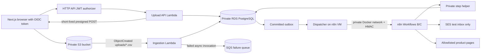

# M8 AWS deployment design — offline specification, not a deployment

The approved project budget is **₹0**. Nothing in this document authorizes creating an AWS resource. The committed Serverless Framework file is a future deployment configuration that requires externally approved, billable prerequisites; today the complete executable demonstration stays on Docker Compose, PostgreSQL, LocalStack, and n8n. The assignment explicitly permits local deployment, but its AWS RDS and received-SES-email evidence cannot be claimed from local mocks.

## Boundary and responsibilities

`infrastructure/serverless.yml` defines two real Python 3.12 Lambda handlers, HTTP API routes, the encrypted/private upload bucket, a native filtered S3 notification, independent Lambda IAM roles, a source-account-scoped S3 invoke permission, a failed-invocation SQS destination, CORS allowlists, log retention, VPC attachment, and reserved concurrency. The handler package is built from the existing FastAPI and ingestion code; no placeholder Lambda is used. API Gateway HTTP API JWT authorizers are supported by [Serverless Framework](https://www.serverless.com/framework/docs/providers/aws/guide/serverless.yml). The Lambda adapter reads the **verified** `requestContext.authorizer.jwt.claims.sub`, not a caller header. New AWS batches persist that subject; status and paged errors return 404 for another subject. Local loopback mode remains unauthenticated for the ₹0 demo. Existing local idempotency hashes are unchanged; AWS idempotency hashes include the subject.

The browser currently lacks an OIDC sign-in/token-acquisition screen. Thus the AWS HTTP API is intentionally **not** usable by the present M7 UI without a later authenticated frontend integration. Removing the JWT authorizer to make it work would create an unsafe anonymous presign API. This is a deployment blocker, not an invitation to expose it.

## VPC and RDS prerequisite

The template imports two private subnet IDs, one Lambda security-group ID, the private RDS hostname, runtime DB username, and a Secrets Manager ARN. It creates **no RDS, EC2, VPC, NAT, or internet-facing n8n host**. A future authorized deployment must first provide a private PostgreSQL 16 RDS instance, encrypted storage, automatic backups/retention, deletion protection, and security-group ingress on 5432 **only** from Lambda and the n8n VM groups. Run Alembic with a separate migration role from a private-network operator host; Lambda and the helper use only the restricted DML role. `NullPool` and ingestion reserved concurrency 2 limit connection pressure; RDS Proxy is deferred. The Lambda private subnet route tables must have an S3 **gateway endpoint**, which has no additional endpoint charge and avoids a NAT gateway for object reads ([AWS gateway endpoints](https://docs.aws.amazon.com/vpc/latest/privatelink/gateway-endpoints.html)).

The runtime DB password uses a CloudFormation Secrets Manager dynamic reference in the Lambda environment. The secret itself and n8n credentials are not in the repository. This still incurs Secrets Manager charges in an actual deployment. SQLAlchemy forces encrypted PostgreSQL transport in AWS mode. It currently uses `sslmode=require`, which encrypts but does not verify the server certificate; `verify-full` plus an RDS CA bundle is a pre-public-deployment hardening item, not a claimed completed control. [AWS documents the RDS CA bundles and verification approach](https://docs.aws.amazon.com/AmazonRDS/latest/UserGuide/UsingWithRDS.SSL.html).

## n8n placement options

| Option | Connectivity | Cost/reliability trade-off | Decision |
|---|---|---|---|
| Local n8n with controlled exposure | Needs VPN/tunnel to private RDS and a reachable webhook; a raw public RDS endpoint is unacceptable | ₹0 local demo, unsuitable for unattended cloud operation | Use only for local demo |
| Small VM in the same VPC | Docker Compose n8n, private helper and dispatcher share Docker networking; VM SG reaches RDS, editor bound to loopback and accessed through an operator tunnel | Fixed VM/EBS/public-IPv4 charges and single-host failure domain, but minimal cloud complexity | Preferred **future** cloud demo if spending is authorized |
| Managed container host | Private networking and scaling possible | More control-plane/endpoints/possibly load-balancer cost and operational configuration | Defer |

The existing local `docker-compose.yml` remains the zero-spend runtime. On a future VM, n8n and its helper/dispatcher require a cloud-specific Compose environment using the private RDS host and separate n8n logical database; the local Compose file must **not** be copied unchanged because it would also launch PostgreSQL and LocalStack. Keep ports 5678 and 8001 private; the dispatcher can use `http://n8n:5678` on the Docker network, which its transport allowlist already supports. n8n's SES credential belongs in its encrypted credential store or an instance role with only `ses:SendEmail` for a verified sender. Never route sends to CSV addresses. The VM needs egress to allowlisted source sites and AWS APIs; a public-subnet VM with tightly restricted inbound rules avoids a NAT gateway but incurs public IPv4 charges and still needs deliberate hardening. No VM is configured or started in M8.

## Events and failure recovery

S3 notification filters on `uploads/` and `.csv`. AWS may deliver events more than once; the M3 worker checks bucket/key/ETag, locks the batch, and avoids duplicate user/outbox rows. S3 invokes Lambda asynchronously; the template limits retry count and event age, then sends exhausted failures to SQS for operator inspection/redrive. A queue message is not auto-redriven. Successful ingestion commits a ready outbox event in the same transaction. The separate dispatcher must run on the private n8n host; it claims due events atomically, HMAC-signs small payloads, and retries until n8n durably accepts them. Workflow C remains test-recipient-only. See [matching](matching-workflow.md) and [notification](notification-workflow.md) recovery contracts.

## Stage and lifecycle boundaries

Stage is a required explicit operational choice (`dev` or `prod`), with a unique global S3 bucket name and stage-suffixed Lambda/queue names. There is no default AWS credential, RDS instance, n8n host, OIDC provider, or SES identity in this repository. The bucket expires source CSV objects after seven days; database retention and legal requirements need owner review before deployment. The CloudFormation stack cannot be safely removed while the bucket contains objects; rollback is a separate controlled operation. The template's fixed resource costs and external prerequisites make any cloud execution **BLOCKED_BY_ZERO_BUDGET**.
