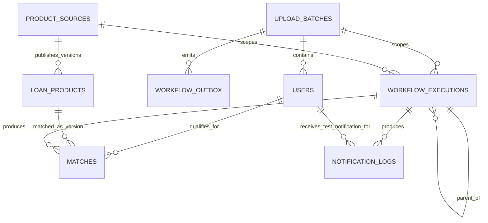
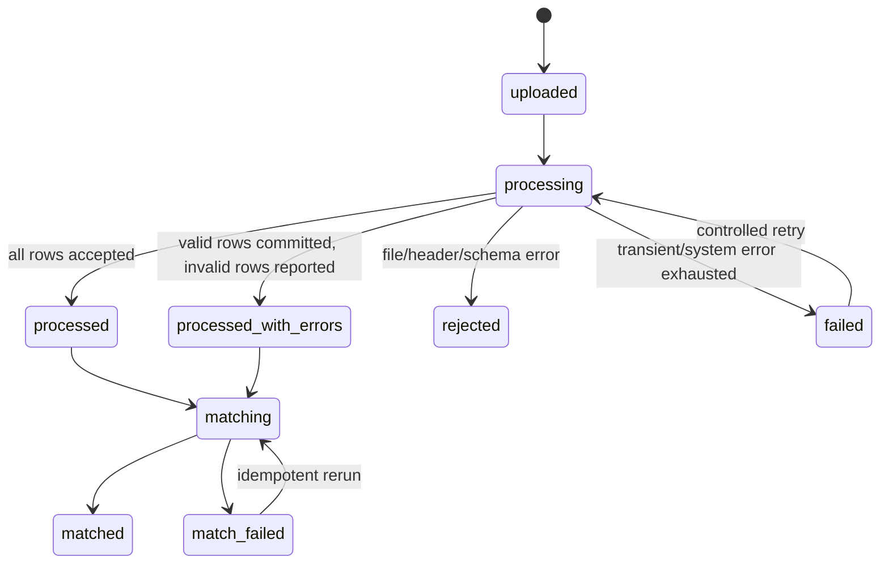

# PostgreSQL Database Design

## Design goals

- Preserve the upload batch boundary from object creation through matching and notification.
- Make every at-least-once event safe to replay.
- Keep eligibility decisions source-grounded, versioned, and explainable.
- Use set-based queries without persisting the rejected Cartesian product.
- Prevent duplicate users within a batch, duplicate matches, and duplicate notification attempts.
- Avoid premature partitioning, generic entity-attribute-value models, and database triggers containing business workflows.

No migrations are created in this phase. Types and constraints below are the migration contract for M2 and may change only through a documented review.

## Entity relationship model



## Conventions

- UUID primary keys are application-generated UUIDv7 when the selected library/runtime supports it reliably; otherwise UUIDv4. Do not depend on ordering semantics for correctness.
- All timestamps are `TIMESTAMPTZ`, stored in UTC and named `*_at`.
- Money/rates use `NUMERIC`, never floating point. User income carries an explicit `income_currency` (default chosen only after the sample data is inspected).
- Emails use PostgreSQL `CITEXT` if the extension is approved in M2; otherwise a normalized lowercase comparison column. Original display value need not be retained for this assignment.
- Status values use constrained text or PostgreSQL enums. Constrained text is easier to evolve; the exact migration choice is deferred to M2.
- JSONB is reserved for versioned eligibility documents, bounded diagnostics, and evidence—not for fields that need ordinary relational filtering.

## Core tables

### `upload_batches`

One row per accepted S3 object key. It is both the ingestion idempotency boundary and the unit passed to Workflow B.

| Column | Type | Null? | Notes |
|---|---|---:|---|
| `id` | UUID PK | No | Generated by presign API and encoded in the object key. |
| `object_bucket` | TEXT | No | Validated expected bucket. |
| `object_key` | TEXT | No | Unique; expected `uploads/<batch-id>/users.csv`. |
| `object_version_id` | TEXT | Yes | Used if bucket versioning is enabled. |
| `object_etag` | TEXT | Yes | Diagnostic only; not treated as a content hash. |
| `content_sha256` | TEXT | Yes | Computed while parsing; unique may be considered only if exact file replay should be globally rejected. |
| `schema_version` | SMALLINT | No | CSV contract version. |
| `status` | TEXT | No | See state machine below. |
| `total_rows` | INTEGER | No | Default 0, check `>= 0`. |
| `accepted_rows` | INTEGER | No | Default 0, check `>= 0`. |
| `rejected_rows` | INTEGER | No | Default 0, check `>= 0`. |
| `error_summary` | JSONB | Yes | Bounded error codes/counts/sample row numbers; no full raw CSV or secrets. |
| `created_at` | TIMESTAMPTZ | No | First observed/presigned timestamp. |
| `processing_started_at` | TIMESTAMPTZ | Yes | Operational visibility. |
| `processed_at` | TIMESTAMPTZ | Yes | Set only after committed ingestion. |
| `updated_at` | TIMESTAMPTZ | No | Application maintained. |

Constraints/indexes:

- `UNIQUE (object_bucket, object_key)`.
- Checks: `accepted_rows + rejected_rows <= total_rows` and counters non-negative.
- Index `(status, updated_at)` supports stuck-batch recovery.
- Validate `id` equals the UUID segment in `object_key` in application code; a complex database regex check adds little value.

State transitions:



Whether `processed_with_errors` is allowed is an open product decision. Until confirmed, M3 tests both policies and documents the selected one.

### `users`

A validated CSV record scoped to exactly one upload. Cross-batch identity is intentionally not inferred from email alone.

| Column | Type | Null? | Notes |
|---|---|---:|---|
| `id` | UUID PK | No | Internal identifier. |
| `upload_batch_id` | UUID FK | No | References `upload_batches(id)`; restrict deletion. |
| `source_user_id` | TEXT | No | CSV `user_id`, length bounded. |
| `email` | CITEXT/TEXT | No | Syntax and length validated; PII redacted from logs. |
| `monthly_income` | NUMERIC(14,2) | No | Check `>= 0`; currency meaning is explicit. |
| `income_currency` | CHAR(3) | No | ISO 4217 code once sample contract is confirmed. |
| `credit_score` | SMALLINT | No | Broad DB check `0..1000`; source-specific range belongs in CSV validation. |
| `employment_status` | TEXT | No | Normalized controlled vocabulary plus validation; do not guess unknown mappings. |
| `age` | SMALLINT | No | Broad sanity check `0..130`; actual lender minima are product rules. |
| `created_at` | TIMESTAMPTZ | No | Ingestion timestamp. |

Constraints/indexes:

- `UNIQUE (upload_batch_id, source_user_id)` prevents a duplicate source identity within a file/retry.
- Consider `UNIQUE (upload_batch_id, email)` only if the assignment owner confirms emails must be unique in a file; do not silently discard two distinct IDs sharing an address.
- Index `(upload_batch_id)` is the primary Workflow B access path.
- Additional numeric indexes are not initially justified for 10,000 rows per batch and only ~50 products. Benchmark before adding `(upload_batch_id, monthly_income, credit_score, age)`; multiple range predicates limit its utility.
- Users are not automatically merged across batches. A canonical-customer table is outside assignment scope and email is not a safe universal identity key.

### `product_sources`

Justified because crawling 2-3 sites needs an allowlist, rate/freshness configuration, and provenance separate from individual product versions.

| Column | Type | Null? | Notes |
|---|---|---:|---|
| `id` | UUID PK | No | Source identity. |
| `name` | TEXT | No | Human-readable institution/site. |
| `base_url` | TEXT | No | HTTPS origin; unique. |
| `discovery_url` | TEXT | No | Allowlisted crawl entry point. |
| `enabled` | BOOLEAN | No | Operational kill switch. |
| `crawl_interval_hours` | SMALLINT | No | Positive, locally rate-limited. |
| `terms_reviewed_at` | TIMESTAMPTZ | Yes | Records review; not legal certification. |
| `robots_reviewed_at` | TIMESTAMPTZ | Yes | Records review. |
| `last_attempted_at` | TIMESTAMPTZ | Yes | Freshness/operations. |
| `last_succeeded_at` | TIMESTAMPTZ | Yes | Freshness/operations. |
| `created_at`, `updated_at` | TIMESTAMPTZ | No | Audit timestamps. |

### `loan_products`

Rows are immutable eligibility versions. When source content changes materially, insert a new version and make it current; unchanged crawls only update “last seen” metadata. This makes a `matches.product_id` point to exactly the rules evaluated.

| Column | Type | Null? | Notes |
|---|---|---:|---|
| `id` | UUID PK | No | Specific product version. |
| `source_id` | UUID FK | No | References `product_sources(id)`. |
| `source_product_key` | TEXT | No | Stable per-source key, preferably canonical URL/path. |
| `version` | INTEGER | No | Starts at 1, positive. |
| `is_current` | BOOLEAN | No | Exactly one current version per logical product. |
| `product_name` | TEXT | No | Source-derived, length bounded. |
| `canonical_url` | TEXT | No | HTTPS and allowlisted origin. |
| `interest_rate_min_pct` | NUMERIC(7,4) | Yes | Nullable when source does not state it. |
| `interest_rate_max_pct` | NUMERIC(7,4) | Yes | Check min <= max when both exist. |
| `interest_rate_text` | TEXT | Yes | Source wording/evidence, bounded. |
| `min_monthly_income` | NUMERIC(14,2) | Yes | Source-derived projection for SQL prefilter; null means no stated threshold, not an invented value. |
| `min_credit_score` | SMALLINT | Yes | Source-derived projection for SQL prefilter. |
| `min_age` | SMALLINT | Yes | Source-derived projection for SQL prefilter. |
| `max_age` | SMALLINT | Yes | Source-derived projection for SQL prefilter. |
| `eligible_employment_statuses` | TEXT[] | Yes | Normalized source-derived set; null means no stated restriction. |
| `eligibility_rules` | JSONB | No | Validated document described below. |
| `rule_schema_version` | SMALLINT | No | Parser/validator contract. |
| `raw_eligibility_text` | TEXT | No | Bounded source excerpt used to derive rules. |
| `source_content_sha256` | TEXT | No | Hash of normalized evidence content. |
| `extraction_method` | TEXT | No | `deterministic`, `gemini`, or `mixed`. |
| `model_name` | TEXT | Yes | Exact model identifier when LLM used. |
| `prompt_version` | TEXT | Yes | Reproducibility without storing secrets. |
| `verification_status` | TEXT | No | `verified`, `review_required`, `invalid`, `stale`. Only verified/current products auto-match. |
| `discovered_at`, `last_seen_at` | TIMESTAMPTZ | No | Discovery/freshness. |
| `retired_at` | TIMESTAMPTZ | Yes | Product no longer found/available. |

Constraints/indexes:

- `UNIQUE (source_id, source_product_key, version)`.
- Partial unique index `(source_id, source_product_key) WHERE is_current`.
- Partial index on current verified rows: `(source_id) WHERE is_current AND verification_status = 'verified' AND retired_at IS NULL`.
- Checks for non-negative rates, ordered min/max, positive version, and valid status/method.
- Checks for non-negative projected income/score, sane/ordered age bounds, and no null/duplicate array elements. The projections must be generated from and cross-validated against `eligibility_rules`; they are not a second authoring surface.
- Application transaction locks the logical product before flipping the old current row and inserting a new version.

### Eligibility rule representation

The JSONB rule document is schema-versioned. It represents only source-supported predicates and separates unsupported qualitative text:

```json
{
  "schema_version": 1,
  "all": [
    {
      "field": "monthly_income",
      "operator": "gte",
      "value": "SOURCE_DERIVED_DECIMAL",
      "unit": "SOURCE_DERIVED_CURRENCY_PER_MONTH",
      "evidence": {"quote": "BOUNDED_SOURCE_EXCERPT", "source_url": "https://..."}
    }
  ],
  "any": [],
  "ambiguous": [
    {
      "text": "UNNORMALIZED_SOURCE_CLAUSE",
      "evidence": {"quote": "BOUNDED_SOURCE_EXCERPT", "source_url": "https://..."}
    }
  ]
}
```

Allowed fields and operators are an enum, for example numeric `gte/lte/between` and categorical `eq/in`. Decimal values are serialized as strings to avoid binary floating-point changes. Every predicate requires an evidence reference. The validator rejects unknown fields/operators, impossible ranges, currency mismatch, contradictory clauses, missing evidence, and values absent from the cited source excerpt.

`ambiguous` is not an invitation to guess. If a clause is decision-critical and cannot be safely resolved from available user data and source evidence, the product-user pair is `unknown`, not a match.

### `matches`

Stores qualified pairs only. Rejections remain aggregate execution metrics; persisting 500,000 negative rows would add cost without satisfying the assignment.

| Column | Type | Null? | Notes |
|---|---|---:|---|
| `id` | UUID PK | No | Match identity. |
| `user_id` | UUID FK | No | References `users(id)`. |
| `product_id` | UUID FK | No | References immutable `loan_products(id)` version. |
| `workflow_execution_id` | UUID FK | No | Decision-producing execution. |
| `evaluation_method` | TEXT | No | `deterministic` or `deterministic_plus_llm`. |
| `qualification_reasons` | JSONB | No | Bounded passed-rule codes/evidence pointers; no unsupported marketing claim. |
| `decision_input_sha256` | TEXT | No | Hash of normalized user fields + product version + evaluator version. |
| `matched_at` | TIMESTAMPTZ | No | Decision timestamp. |
| `notified_at` | TIMESTAMPTZ | Yes | Set after successful grouped notification. |

Constraints/indexes:

- `UNIQUE (user_id, product_id)` makes Workflow B reruns idempotent because products are immutable versions.
- Index `(user_id, notified_at)` and partial index `(user_id) WHERE notified_at IS NULL` support Workflow C.
- Index `(product_id)` supports reporting/debugging.
- No match is inserted for `ineligible`, `unknown`, invalid criteria, stale/unverified product, or failed LLM validation.

## Operational tables

### `workflow_outbox`

Justified to make the PostgreSQL commit and n8n handoff recoverable without adding a message broker.

| Column | Type | Null? | Notes |
|---|---|---:|---|
| `id` / `event_id` | UUID PK | No | Sent as webhook event ID. |
| `upload_batch_id` | UUID FK | No | Target batch. |
| `event_type` | TEXT | No | Initially `upload_batch.ready.v1`. |
| `payload` | JSONB | No | Small, schema-validated envelope; no user records. |
| `status` | TEXT | No | `pending`, `delivered`, `failed_permanent`. |
| `attempt_count` | INTEGER | No | Non-negative. |
| `next_attempt_at` | TIMESTAMPTZ | No | Reconciliation query. |
| `last_attempt_at`, `delivered_at` | TIMESTAMPTZ | Yes | Audit. |
| `last_error_code` | TEXT | Yes | Sanitized; no response body containing secrets. |
| `created_at` | TIMESTAMPTZ | No | Audit. |

Index `(status, next_attempt_at)`; optional unique `(upload_batch_id, event_type)` ensures one ready event per batch.

### `workflow_executions`

Justified for idempotent event claims, workflow correlation, stage counts, and demo/debug evidence without relying solely on n8n’s internal database.

| Column | Type | Null? | Notes |
|---|---|---:|---|
| `id` | UUID PK | No | Application execution ID. |
| `n8n_execution_id` | TEXT | Yes | Unique when supplied by n8n. |
| `event_id` | UUID | Yes | Unique event claim for webhook-triggered executions. |
| `parent_execution_id` | UUID FK self | Yes | Workflow B -> C correlation. |
| `workflow_type` | TEXT | No | `discovery`, `matching`, `notification`, `outbox_reconcile`. |
| `upload_batch_id` | UUID FK | Yes | Required for matching/notification. |
| `source_id` | UUID FK | Yes | Optional discovery scope. |
| `status` | TEXT | No | `running`, `succeeded`, `failed`, `partial`. |
| `metrics` | JSONB | No | Counts/timings with a bounded schema, no PII. |
| `error_code` | TEXT | Yes | Stable code. |
| `started_at`, `finished_at` | TIMESTAMPTZ | No/Yes | Duration and stuck-run detection. |

Constraints ensure the appropriate scope is present for each workflow type. Index `(workflow_type, status, started_at)` and `(upload_batch_id)`.

### `notification_logs`

Justified for SES retries, recipient safety auditing, and idempotency.

| Column | Type | Null? | Notes |
|---|---|---:|---|
| `id` | UUID PK | No | Attempt/group identity. |
| `workflow_execution_id` | UUID FK | No | Notification execution. |
| `user_id` | UUID FK | No | Original matched user; actual recipient is redirected in test mode. |
| `idempotency_key` | TEXT | No | Unique digest of user + sorted new match IDs + template version. |
| `match_ids` | UUID[] | No | Exact matches included; application verifies ownership/existence. |
| `recipient_alias` | CITEXT/TEXT | No | Must pass configured owner-controlled allowlist. |
| `template_version` | TEXT | No | Reproducibility. |
| `status` | TEXT | No | `reserved`, `sent`, `failed`, `ambiguous`. |
| `ses_message_id` | TEXT | Yes | Unique when returned. |
| `attempt_count` | INTEGER | No | Non-negative. |
| `last_error_code` | TEXT | Yes | Sanitized. |
| `reserved_at`, `sent_at`, `updated_at` | TIMESTAMPTZ | No/Yes/No | Audit/recovery. |

Constraints/indexes:

- `UNIQUE (idempotency_key)` prevents the same grouped email from being intentionally sent twice.
- `UNIQUE (ses_message_id) WHERE ses_message_id IS NOT NULL`.
- Index `(status, updated_at)` supports retry/manual-review queues.
- A transaction reserves the notification before SES; after a confirmed send, a transaction updates the log and included matches’ `notified_at`.

## Duplicate prevention and concurrency

1. **Object replay:** unique bucket/key and a row lock on `upload_batches`.
2. **CSV duplicate:** unique batch/source user ID; ingestion reports the duplicate rather than silently choosing a row.
3. **Webhook replay:** unique `workflow_executions.event_id`, claimed atomically before matching.
4. **Concurrent product crawl:** advisory or row lock on source/logical product; partial unique current index.
5. **Match replay:** `INSERT ... ON CONFLICT (user_id, product_id) DO NOTHING RETURNING id`; Workflow C receives only returned new IDs.
6. **Notification replay:** unique deterministic idempotency key and reservation state.

Database constraints are the final guard. Application/n8n prechecks improve messages but are not relied on for correctness.

## Transaction boundaries

- **Ingestion transaction:** claim batch -> bulk insert all accepted users -> update counters/status -> insert outbox event -> commit. No webhook call inside the transaction.
- **Matching claim transaction:** insert/claim execution/event -> transition batch to matching -> commit quickly.
- **Matching write transactions:** chunked `INSERT ... ON CONFLICT`; final transaction stores metrics and batch/execution success. Reruns are safe after partial failure.
- **Product version transaction:** lock logical key -> compare normalized hash -> retire previous current if changed -> insert current version -> commit.
- **Notification:** reserve idempotency key in a short transaction; call SES outside the transaction; finalize result and `matches.notified_at` afterward.

## Data validation ownership

| Layer | Validation |
|---|---|
| Browser/API | File metadata, rough size/type, generated object key. Advisory only. |
| Ingestion/Pydantic | Exact headers/schema version, UTF-8, field lengths/types, email syntax, normalized employment value, numeric bounds, row policy. |
| PostgreSQL | Non-null, FK, unique, broad sanity checks, valid states, final idempotency. |
| Discovery validator | URL allowlist, JSON schema, source evidence, units, ranges, contradictions, known fields/operators. |
| Matching workflow | Current/verified product, deterministic predicate semantics, unknown policy, decision hash. |
| Notification workflow | New matches only, allowlisted/redirected recipient, HTML escaping, idempotency reservation. |

## Retention and privacy

- Store only fields needed by the assignment. Do not log CSV bodies, emails, or Gemini prompts containing user data.
- S3 uploads should expire after a short documented retention period once ingestion/debug needs are satisfied; exact period is an owner decision.
- Database backups and deletion policy are required before a real production deployment but should not become a take-home-sized compliance program.
- `ON DELETE RESTRICT` is the safe initial FK policy. Any future user-deletion workflow must deliberately delete/anonymize dependent records and audit the action.

## Database roles

- `migration_role`: DDL only, never used by runtime.
- `ingestion_role`: insert/update batches/users/outbox; read only what retry handling needs.
- `n8n_role`: read batches/users/current verified products; write executions/products/matches/notifications/outbox status as required. No DDL.
- `api_role` only if a database-backed status endpoint is implemented; read batch-safe fields only.

Credentials live in n8n’s encrypted store or AWS secret storage, not `.env.example` values, workflow exports, or source control.

## Deferred decisions for M2

1. `CITEXT` extension versus normalized email column.
2. UUIDv7 library and PostgreSQL compatibility versus UUIDv4.
3. Partial-row acceptance policy.
4. Currency represented by the supplied sample data.
5. Exact employment-status controlled vocabulary.
6. Whether notification `match_ids` remains a UUID array or becomes a join table if query needs justify normalization.

