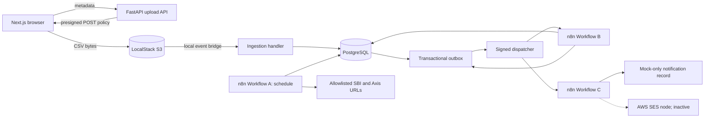
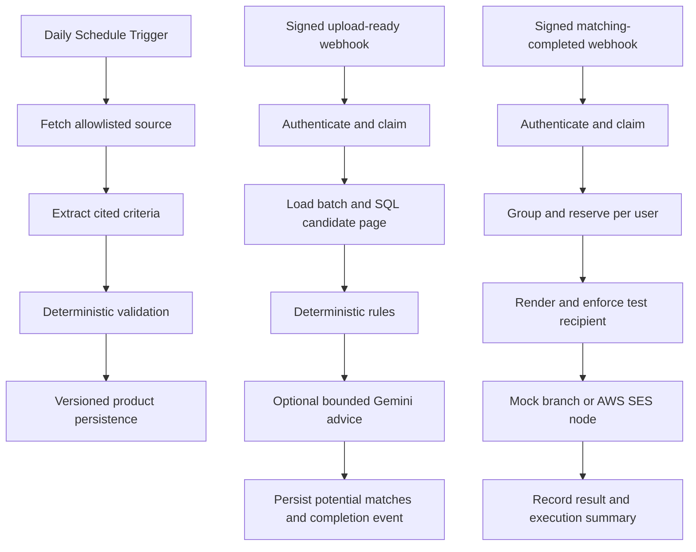
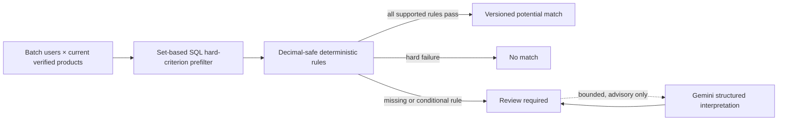
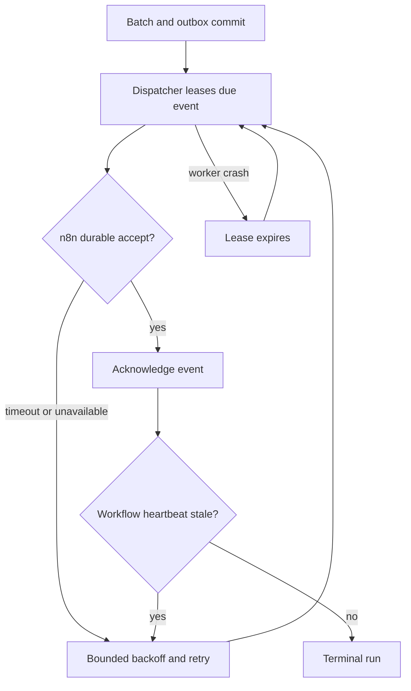

# Final local architecture and future AWS mapping

This is an executable **local** architecture under a ₹0 budget. Solid paths ran with Docker PostgreSQL, LocalStack S3 and n8n; dashed AWS SES is configured but was not invoked. `infrastructure/serverless.yml` describes a future Lambda/S3/RDS deployment, not an existing one.

## System



Production mapping: LocalStack → private S3 with an `ObjectCreated` Lambda notification; local PostgreSQL → private RDS; the local bridge disappears. AWS is not deployed. A private n8n host, OIDC frontend, certificate-verified RDS connection and SES credentials would still be required.

## CSV ingestion sequence

```mermaid
sequenceDiagram
    participant U as Browser
    participant API as Upload API
    participant S3 as LocalStack S3
    participant W as Local event bridge and handler
    participant DB as PostgreSQL
    U->>API: POST /uploads with metadata and idempotency key
    API->>DB: Reserve upload batch
    API-->>U: Batch ID and short-lived presigned POST
    U->>S3: Direct multipart CSV POST
    S3-->>W: Object observed; native S3 event envelope
    W->>DB: Lock batch and stream-validate rows
    W->>DB: Commit users, row errors, status and ready outbox event together
    U->>API: Poll status and paged errors
```

The browser never sends CSV bytes to FastAPI. Duplicate S3 deliveries and upload idempotency keys cannot duplicate committed users or ready events. Invalid files create no matching event.

## n8n orchestration



Each n8n stage makes a bounded authenticated helper call or runs a visible branch; the workflow is not a single opaque Python endpoint. Workflow A's source allowlist and rate limits are enforced in the helper. Every private helper request carries body-bound HMAC, key ID, timestamp and one-time nonce; the nonce is reserved in PostgreSQL. The local n8n signer reads its key from environment, so this configuration is **single-owner loopback only**, not safe for a shared editor.

## Matching optimization



PostgreSQL performs candidate reduction because indexes, set operations and `NULL` semantics can be tested and explained without transferring a 10,000×50 Cartesian product into n8n memory. The rule engine compares age, credit, employment and `Decimal` income only when units are known. LLM extraction is selective and advisory; it cannot override a hard failure or promote an unsupported criterion. Official SBI and Axis versions remain `review_required`; only opt-in synthetic products yield demonstration positives.

## Notification lifecycle

```mermaid
stateDiagram-v2
    [*] --> Reserved: unique user/batch reservation
    Reserved --> Sending: guarded attempt
    Sending --> Mocked: local mock accepted
    Sending --> Sent: SES returns message ID; not inbox receipt
    Sending --> Failed: known rejection
    Sending --> Ambiguous: timeout or crash after possible acceptance
    Ambiguous --> [*]: manual reconciliation; no blind resend
    Mocked --> [*]
    Sent --> [*]
    Failed --> [*]
```



Only `potential` matches are grouped once per user. CSV email addresses are never delivery destinations. The template includes a potential-not-approval disclaimer, escaped HTML and official source links; synthetic products are explicitly labelled. The installed SES node does not produce multipart HTML+plain-text in one send. No SES send or inbox receipt has been verified.

## Failure recovery



The outbox prevents the database-commit/webhook gap. Delivery is at least once; webhook claims, match uniqueness and notification reservations make repeats safe. A crash after SES accepts but before its result is stored is ambiguous and must not trigger an automatic resend. The local mock branch does not prove SES acceptance.

## Why these components

Python was selected over Go because the existing FastAPI/Pydantic/SQLAlchemy validation stack and thin Lambda handlers keep the take-home understandable and testable. n8n is required by the assignment and owns scheduling, branches, stage order and execution visibility. The transactional outbox adds one PostgreSQL table, not a queue platform, to bridge ingestion and n8n reliably. Immutable product versions preserve source URL, retrieved timestamp, evidence excerpts and extraction provenance; unsupported facts remain unknown. Explicit `source_type=synthetic` and opt-in demo batches isolate invented test rules from real banks. See the [matching policy](matching-policy.md), [notification policy](notification-policy.md) and [AWS deployment design](aws-deployment-design.md) for boundaries.
