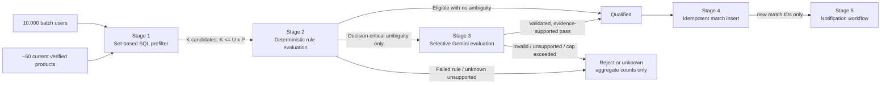

# Optimization Strategy: The Eligibility Treasure Hunt

## Goal and safety invariant

For 10,000 users and 50 products, the naive Cartesian space is 500,000 user-product pairs. The goal is not to pretend those relationships do not exist; it is to evaluate cheap, selective predicates close to the data, transfer only surviving candidates into n8n, and reserve LLM work for a small, explicitly bounded ambiguity set.

The safety invariant is:

> A user is matched only when every decision-critical eligibility condition is supported by source evidence and evaluates true. Missing, stale, contradictory, or unvalidated information produces `unknown`, never an invented pass.

## Pipeline



Let:

- `U` = users in the new batch (scenario: 10,000)
- `P` = current, verified products (scenario: 50)
- `K` = pairs surviving SQL prefilter
- `A` = decision-critical ambiguous pairs after deterministic rules
- `M` = newly inserted qualified matches
- `R` = average number of predicates evaluated per candidate

The architecture enforces `A <= K <= U × P` and measures all three values. It does not assert a reduction percentage before representative data exists.

## Stage 0: product normalization once, not per user

Workflow A converts source criteria into a versioned rule schema. Common numeric/categorical predicates are cross-validated into relational projections on `loan_products`:

- `min_monthly_income`
- `min_credit_score`
- `max_credit_score` when the source states an upper bound
- `min_age` / `max_age`
- `eligible_employment_statuses`

The full source-grounded rule document remains in JSONB. The projections are derived values, not separately invented criteria. A product with invalid, stale, contradictory, or unknown numeric criteria is not `verified` and does not enter automatic matching.

This moves LLM-assisted interpretation, when needed, from potentially `U × P` pair evaluations to product-version extraction—approximately proportional to changed product pages.

## Stage 1: set-based SQL prefilter

Workflow B invokes a parameterized PostgreSQL query for only the new `upload_batch_id`. Conceptually:

```sql
SELECT
    u.id AS user_id,
    p.id AS product_id,
    u.monthly_income,
    u.credit_score,
    u.age,
    u.employment_status,
    p.eligibility_rules,
    p.rule_schema_version
FROM users AS u
JOIN loan_products AS p
  ON p.is_current
 AND p.verification_status = 'verified'
 AND p.retired_at IS NULL
 AND (p.min_monthly_income IS NULL OR u.monthly_income >= p.min_monthly_income)
 AND (p.min_credit_score IS NULL OR u.credit_score >= p.min_credit_score)
 AND (p.max_credit_score IS NULL OR u.credit_score <= p.max_credit_score)
 AND (p.min_age IS NULL OR u.age >= p.min_age)
 AND (p.max_age IS NULL OR u.age <= p.max_age)
 AND (
      p.eligible_employment_statuses IS NULL
      OR u.employment_status = ANY (p.eligible_employment_statuses)
 )
WHERE u.upload_batch_id = :batch_id
ORDER BY u.id, p.id;
```

Implementation details:

- Use bound parameters; never interpolate the batch ID.
- Fetch/process candidates in bounded pages or n8n item batches. Do not construct one 500,000-element JavaScript array.
- Select only fields required by later rules; never move email into the matching stages.
- For 50 products, a planner may reasonably scan the small product relation and the 10,000-user batch. The worst case still performs `O(U × P)` cheap comparisons inside PostgreSQL, but data transfer and expensive work are `O(K)`.
- Evaluate an alternative product-driven plan (roughly one indexed user-range query per product) in the benchmark. Do not add numeric indexes until `EXPLAIN (ANALYZE, BUFFERS)` shows they improve the representative workload; combined range predicates often limit a composite index.
- Null means “the verified source states no restriction for this projected field.” It must not be used to hide a failed extraction. Extraction completeness/status is checked before the product is matchable.

Why SQL first: PostgreSQL evaluates typed comparisons in a set, close to storage, with no per-pair network or LLM overhead. n8n still orchestrates the stage and owns the business workflow.

## Stage 2: deterministic eligibility rules

Candidates are processed in bounded n8n batches by a version-controlled, unit-tested rule evaluator embedded in the workflow Code node (or native expression nodes where clearer). It evaluates the full rule document:

- numeric comparisons with exact decimals and explicit units;
- categorical `eq`/`in` comparisons against normalized values;
- `all` and constrained `any` groups;
- missing user fields and unsupported operators as `unknown`;
- source/rule schema version compatibility;
- a list of passed/failed/unknown rule codes for explainability.

The evaluator is pure: same normalized inputs and evaluator version produce the same result and `decision_input_sha256`. It performs no database, network, or LLM calls. Numeric comparisons are never delegated to Gemini.

Candidates that fail any required rule stop here. Candidates that pass every condition with no decision-critical ambiguity proceed directly to Stage 4. Only a candidate whose deterministic rules pass and whose remaining source-supported condition is genuinely qualitative may enter Stage 3.

## Stage 3: selective LLM evaluation

This stage is a guarded exception, not the default matcher.

Admission criteria:

1. The product is current and verified.
2. All deterministic predicates passed.
3. The unresolved clause is present verbatim in source evidence.
4. Required user data exists and can be minimized to non-identifying fields.
5. The clause uses an allowlisted qualitative evaluation type with a defined JSON output schema.
6. Per-execution pair/call/time/token caps have not been reached.

The prompt sends a bounded source excerpt, the normalized non-PII user attributes needed for that clause, rule/evaluator versions, and a strict response schema such as:

```json
{
  "decision": "eligible | ineligible | unknown",
  "reason_code": "ALLOWLISTED_CODE",
  "source_evidence": "EXACT_BOUNDED_EVIDENCE",
  "input_facts_used": ["employment_status"]
}
```

Controls:

- Pin an available Gemini Flash model version during implementation; do not leave “latest” unreviewed.
- Request structured JSON with low/zero temperature.
- Validate types, enum values, evidence containment, allowed fields, and consistency. Discard prose outside the schema.
- Cache by the hash of product version + ambiguous clause + normalized relevant facts + prompt/model version. Never cache by email/name.
- Small bounded batching may reduce request overhead, but each returned item must correlate uniquely and validate independently.
- Transient API failures receive a small retry budget. Invalid output, quota cap, or unresolvable ambiguity becomes `unknown` and creates no match.

In many realistic schemas, Stage 3 may receive zero pairs because employment status and numeric thresholds are deterministic. Zero LLM calls is a valid and preferable outcome—not evidence that AI was forgotten.

## Stage 4: persist qualified matches

Workflow B writes only qualified pairs using a set-based insert or bounded chunks:

```sql
INSERT INTO matches (
  id, user_id, product_id, workflow_execution_id,
  evaluation_method, qualification_reasons,
  decision_input_sha256, matched_at
)
SELECT ...
ON CONFLICT (user_id, product_id) DO NOTHING
RETURNING id, user_id;
```

`RETURNING` identifies `M`, the newly created matches. Existing matches are not re-notified. Store concise passed-rule codes and evidence pointers, not an LLM chain-of-thought and not every rejected pair.

Execution metrics record:

- input user/product counts;
- theoretical pair count `U × P`;
- candidates `K`;
- deterministic pass/fail/unknown counts;
- ambiguous pairs `A`, calls, cache hits, validation failures;
- inserted matches `M` and conflicts;
- stage durations and peak batch size.

Metrics contain no PII.

## Stage 5: notify only new matches

Workflow B calls Workflow C only after its final database success, passing the execution ID and new match IDs (or a database query key), not entire user records. Workflow C:

1. groups new matches by user;
2. reserves a deterministic notification idempotency key;
3. loads only required product/email data;
4. redirects to an owner-controlled test alias and refuses sample recipients;
5. sends through the n8n AWS SES node;
6. records the SES result and marks included matches notified.

If `M = 0`, the workflow records a successful no-op and sends nothing.

## Strategy comparison

| Strategy | Expensive evaluations | Database/application work | Strengths | Weaknesses | Decision |
|---|---:|---|---|---|---|
| A. Naive LLM per pair | `U × P` = 500,000 scenario decisions | Minimal filtering, enormous network/serialization | Simple concept; can read prose | Prohibitive request count/latency/cost; nondeterministic numeric decisions; quota and privacy risk; poor explainability | Reject |
| B. SQL + deterministic rules | 0 LLM pair calls | Worst-case `O(U × P)` cheap SQL comparisons; `O(K × R)` deterministic rules | Fast, reproducible, cheap, testable, explainable | Cannot safely decide genuinely qualitative clauses; rule-schema maintenance | Default for all expressible criteria |
| C. SQL + deterministic + selective LLM | `O(A)` pair evaluations, where `A <= K` and is capped | Same as B plus validation/cache | Covers narrow source-supported ambiguity while bounding cost | More failure modes/versioning; still nondeterministic; must fail closed | Use only behind admission controls |

An important nuance: big-O alone does not capture the improvement. Stage 1 may still inspect the Cartesian relationship, but it replaces remote model calls with in-process typed comparisons and reduces downstream transfer from `U × P` to `K`. Actual selectivity—not an invented estimate—must be measured.

## Query and memory efficiency

- Load the 50 current product versions once per execution or let SQL join them; do not query products once per user.
- Use one batch-scoped candidate query, cursor/keyset pagination where supported, and bounded n8n Split in Batches/Loop Over Items nodes.
- Avoid n8n expression patterns that copy the full product list into every item.
- Bulk insert users and matches; avoid one SQL node invocation per row/pair.
- Keep transactions short and external calls outside them.
- Apply n8n execution-data retention/pruning so large successful payloads do not grow its internal database indefinitely; retain operational metrics and failed-run evidence.
- Log IDs/counts and stable error codes, not emails, CSV rows, or full LLM prompts.

## Reproducible benchmark methodology

No performance result is claimed in this planning phase. M5 will add a benchmark harness with the following protocol.

### Dataset

1. Use a fixed random seed and generator version.
2. Generate exactly 10,000 users with documented distributions and boundary cases for income, credit score, age, and employment status. Do not tune distributions after seeing results without creating a new named dataset version.
3. Generate 50 source-grounded *synthetic benchmark* products with a declared mix of numeric, categorical, and ambiguous criteria. Label them synthetic so they cannot be confused with real offers.
4. Include deterministic golden cases at every threshold (`x-1`, `x`, `x+1` or appropriate decimal equivalents), null/unknown fields, duplicate events, and contradictions.
5. Save only the seed/config and expected aggregate golden results if the full generated dataset is unnecessary in Git.

### Environment capture

- Record CPU/memory, OS/container versions, PostgreSQL version/settings, n8n version/execution mode, Python/Node versions, schema migration, model/prompt version, and whether caches are warm.
- Pin container images/dependencies.
- Run on an otherwise idle local machine or dedicated CI class; record the class, not a vague “fast laptop.”

### Runs

1. Reset database tables and seed the same dataset before each strategy.
2. Run one warm-up, then at least five measured repetitions; report every run plus median and p95 where the sample size is disclosed. Do not present p95 from too few observations without qualification.
3. Measure B and C end-to-end locally with the Gemini adapter stub first. A does not make 500,000 paid calls: count requests/tokens from serialized fixtures and, if useful, measure a small explicitly labeled sample to estimate per-call latency. Keep projection formulas separate from measured results.
4. For SQL, capture `EXPLAIN (ANALYZE, BUFFERS, WAL)` for candidate queries and compare no-index versus candidate indexes after `ANALYZE`.
5. For a deliberately enabled live Gemini trial, use a capped sample, record cache state/rate limits/retries and actual provider usage, and never extrapolate as a benchmark fact without confidence bounds and assumptions.
6. Validate that all strategies being compared produce the same outcomes for deterministic golden cases; performance is irrelevant if correctness differs.

### Metrics

| Dimension | Metrics |
|---|---|
| Correctness | Expected/actual qualified pairs, false positive/negative golden cases, unknown count, idempotent rerun differences. |
| Funnel | `U`, `P`, `U×P`, `K`, deterministic pass/fail/unknown, `A`, `M`, reduction ratios calculated from recorded counts. |
| Latency | End-to-end and per-stage wall time; database time; LLM queue/network time; median/p95 with raw runs. |
| Database | Rows scanned/returned, shared buffer hits/reads, temp spill, query plan, connections, WAL bytes for inserts. |
| n8n/runtime | Peak batch size, workflow execution data size, memory/CPU where available, failed/retried nodes. |
| LLM | Calls, items/call, input/output tokens, cache hits, invalid responses, retries, capped/unknown results. |
| Cost model | Current provider unit price × measured usage plus labeled fixed infrastructure assumptions; date/region/source recorded. |

### Acceptance targets to set after baseline

Do not invent millisecond or percentage targets now. After the first reproducible run, define targets for:

- zero LLM calls for purely numeric/categorical datasets;
- bounded maximum `A` and calls per workflow execution;
- no duplicate users/matches/notifications on a full rerun;
- no unbounded n8n memory growth at the 10,000 × 50 scenario;
- explainable reason codes for every inserted match;
- an agreed local completion-time budget.

## Explainability and audit output

For each match the UI/email may safely say “based on the supplied data, you may qualify,” not that a loan is approved. Internally, the match records product version, evaluator version through execution metadata, decision input hash, method, and passed reason codes/evidence pointers. This supports interview explanation and later debugging without storing private model reasoning.

